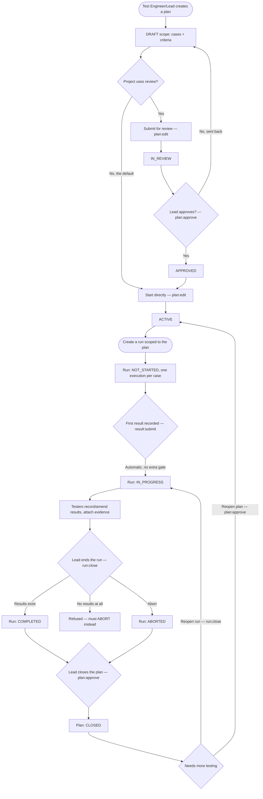

# FLOW-003 — Plan a release, run it, execute, close

**Created:** 2026-08-03 · **Owned by:** `ba-process-flow-diagram`
**Derived from:** code by `be-documenter` @ `93444b2` on 2026-08-03
**Areas:** AREA-004 (Test Execution)
**Entities:** ENT-002 (plan lifecycle), ENT-003 (run lifecycle)

`#observed` — nodes evidenced in `PlanLifecycle.java` (ENT-002), `RunLifecycle.java` and
`RunController.java` (ENT-003), `ExecutionService`/`RunLifecycle.java:19-30` (auto-start on
first result). The composition into one end-to-end flow is this document's synthesis.

## Notes

- A run's completion is deliberately never automatic, even when every case in scope has a
  result — "done" is a lead's judgement call (ENT-003 R1).
- A plan can be closed and reopened independently of its runs being closed and reopened; the
  two lifecycles are separate state machines that a team coordinates manually. Not independently
  verified whether the system cross-checks plan/run state consistency — flagged as an open
  question below.

## Open question

Does closing a plan need to check that its runs are also closed (or vice versa), or is that
left entirely to the team's own process? No cross-check between `PlanLifecycle` and
`RunLifecycle` was found in this trace. `#inferred`
