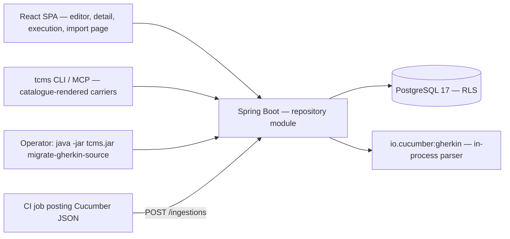
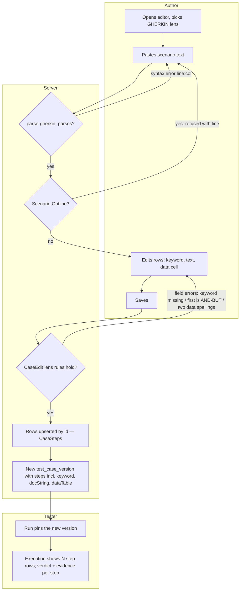
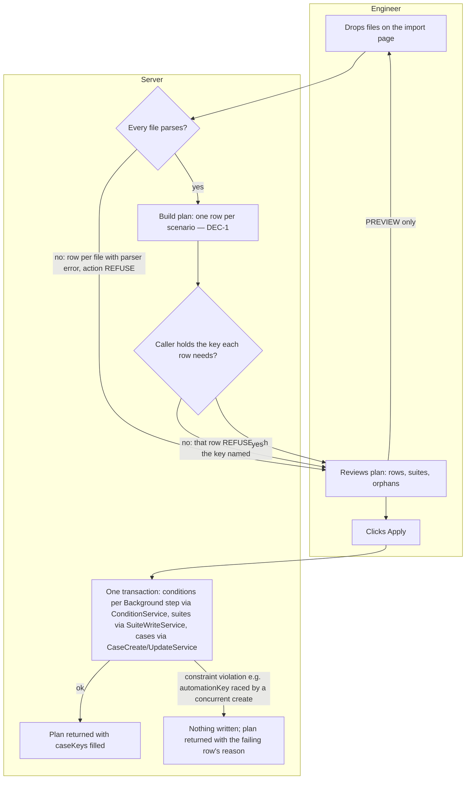
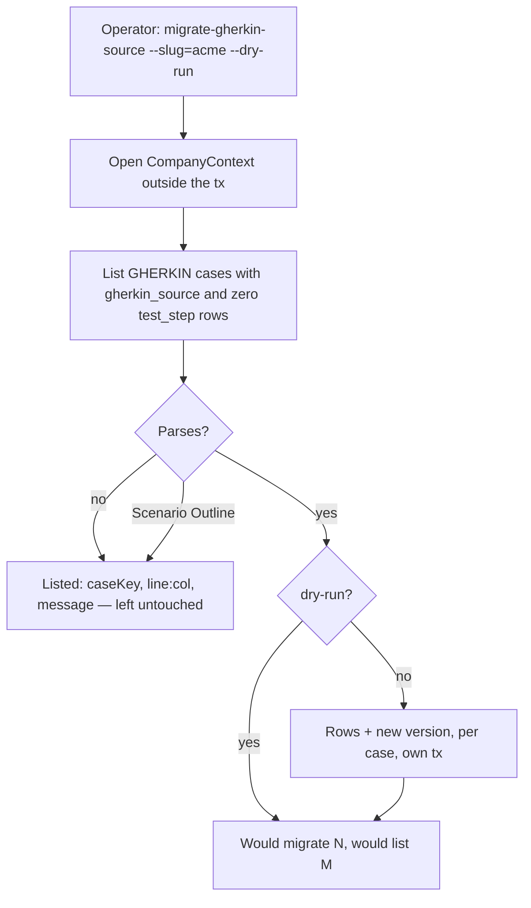

# Unified step model & `.feature` import — Solution Blueprint

**Date:** 2026-08-27 · **Written by:** `be-shared-solution-blueprint` (via `be-planner`) · **Status:** APPROVED 2026-08-27 — the decisions are in §10a; every `proposed` row below is `proposed → approved` unless §10a says otherwise
**Initiative folder:** `docs/plans/001-unified-step-model/` — the first `NNN`-prefixed entry under `docs/plans/`; every other file there is date-prefixed, so the high-water mark was empty and `001` is the next free number.
**Entry mode:** DETAIL, grounded in the code — a human-written high-level plan exists (`docs/plans/2026-08-27-unified-step-model.md`, *"status: proposal, nothing built"*), no detail pack exists, and the code confirms nothing of it is built: no `io.cucumber:gherkin` dependency in `backend/build.gradle.kts`, `CaseEdit.validate` still writes `List.of()` steps for a `GHERKIN` case (`CaseEdit.java:400`), and `test_step.docstring` / `datatable` are unmapped (`TestStep.java:41-45`).
**Sources:**

| Source | What it contributed |
|---|---|
| `docs/plans/2026-08-27-unified-step-model.md` | The proposal itself — the design, the mapping tables, the two-call import, the permissions, the sequencing. Every claim below marked `stated` comes from it. |
| `docs/plans/2026-07-30-tcms-high-level-plan.md` §6a | The four rules the proposal keeps, the three sync modes, and the "M4 import/export" placement it moves. |
| `backend/src/main/java/com/tcms/repository/{TestStep,CaseEdit,CaseSteps,CaseCompleteness,CaseVersions,TestCase,SuiteService}.java`, `execution/{ExecutionViews,CucumberReportParser,TestExecutionView}.java`, `provisioning/ExportCompanyCommand.java` | The seams the plan reuses and the two premises it got wrong (§3b, §9). |
| `backend/src/main/resources/db/migration/{V1,V2,V68}` | `test_step` DDL (`V1:593-612`), `test_case.gherkin_source` (`V1:500`), `case_condition.inline_body` still in DDL (`V1:621`), the search-vector trigger reading `gherkin_source` (`V2:75`), head `V68`. |
| `docs/specs/openapi.yaml` | `TestStep` (`:9498`), `TestStepInput` (`:9515`), `TestCaseInput` (`:9345`), `StepResult` (`:11391`), `CaseConditionInput` (`:9806`). |
| `docs/specs/2026-07-30-tcms-roles-permissions-naming.md` §A3 | The 55-key catalogue; `case:create`, `case:edit`, `suite:manage`, `library:manage` rows (`:141-147`). |
| `frontend/src/features/cases/{CaseEditorPage,CaseDetailPage,caseSchema}.ts(x)`, `features/runs/ExecutionPage.tsx` | The SPA readers and writers of `gherkinSource`. |
| `packages/client/src/core/{shapes,rewrite,proposal}.ts`, `docs/handoff/254-*.md` | The §254 shape catalogue's step entry (`shapes.ts:227-260`) and the two other `gherkinSource` consumers. |
| `docs/agent-context/{be-java,fe-react}.md`, `docs/HANDOFF.md`, `CLAUDE.md` | Version lane, gates, the shanks rule, §65 deferral, the sequential-work rule. |

---

## 1. The initiative

Today a `GHERKIN` case is a text blob with a chip on it: `test_case.gherkin_source` holds the scenario, the case has zero `test_step` rows, and so nothing that makes a structured case a test case — stable step ids, per-step verdicts and evidence, completeness, step suggestions, version snapshots of steps — applies to it. The proposal makes **every case an ordered list of step rows**, where a step *may* carry a Gherkin keyword and the two block-argument columns V1 already built (`docstring`, `datatable`) finally get a field on the contract. `stepFormat` becomes the authoring lens, not the storage.

On top of that one model, Gherkin text becomes a *view*: a server-side parse turns pasted text into rows, a renderer turns rows back into a canonical `.feature`, and — one altitude up — a **feature-file import** turns a folder of `.feature` files into a suite per feature and a case per scenario, each already keyed for the first Cucumber report a team posts.

For: authors who think in Gherkin (they keep a textarea, as a *paste* action), testers executing Gherkin cases (they get per-step verdicts for the first time), and teams with an existing automation repo (they drop it in). Success: a Gherkin case executes step by step with evidence anchored to stable ids; `CaseCompleteness` no longer special-cases a format; a three-feature import followed by a Cucumber report posts with zero `unmatched`.

**Success signals:** a Gherkin case yields one `step_result` per step on its next execution (`#confirmed` — the proposal's §5) · `CaseCompleteness.recomputeIncomplete` has no `GHERKIN` branch (`#confirmed`) · an imported suite's first Cucumber ingestion reports `unmatched_count = 0` (`#confirmed`, §3b) · the operator backfill lists every unparsable case rather than silently skipping it (`#confirmed`, §4).

## 2. Functional areas

| Area | Purpose | User-facing capabilities | Primary actors | Key entities | In scope | Out of scope | Depends on |
|---|---|---|---|---|---|---|---|
| **A. One step model** | Every case's procedure is step rows; keyword and block arguments are per-step properties; the lens (`stepFormat`) only decides what is required | *An author writes a Gherkin case as keyword step rows, each with an optional docstring or table, saves it, and toggles the lens both ways losing nothing* · *A tester executes a Gherkin case and records a verdict, comment and evidence per step* | Author (`case:create`/`case:edit`), tester (`run:execute`) | `test_step` (gains `docstring`, `datatable` on the entity and contract; a one-data check constraint), `test_case` (stops writing `gherkin_source`), `test_case_version` snapshot (gains the two fields) | Contract (`TestStep`/`TestStepInput`/`TestCaseInput`), `CaseEdit` lens rules, `CaseCompleteness`, `V69`, the SPA editor / detail / execution renderers, the §254 catalogue entry for a step | Dropping `gherkin_source` and `inline_body` from the schema (§4.3 contract phase — a **follow-up initiative**, see the boundary below); `Scenario Outline` / `dataSets`; Cucumber *per-step* result attachment | — (foundation for B, C, D) |
| **B. Gherkin text in / text out** | Text is a view over rows, never storage | *An author pastes a scenario (or a whole `Feature:` block) and gets rows, a title and an objective back, with parser errors by line* · *A reader views or downloads one case as canonical `.feature` text* | Author, reader | none new — a pure parser/renderer over A's rows (`GherkinScenarios` in `repository`) | `io.cucumber:gherkin` dependency, parse + render, round-trip test, `POST …/cases/parse-gherkin`, `GET …/cases/{id}/feature`, the SPA *Paste Gherkin* dialog and *View as .feature* action | Suite-level `.feature` export, Git sync modes (M4) | A |
| **C. Backfill of existing Gherkin cases** | Existing `gherkin_source` blobs become rows, per company, once, by an operator | *An operator runs `migrate-gherkin-source` for a company (dry-run first) and gets the list of cases whose text did not parse* | Instance operator (CLI, same image as `provision-company`) | `test_case`, `test_step`, `test_case_version` | The operator command, per-company `CompanyContext`, idempotency (skip a case that already has rows), the report | A Flyway migration (impossible — §3b), deleting `gherkin_source` | A, B |
| **D. Feature-file import** | A folder of `.feature` files becomes suites, per-step library preconditions and cases, keyed for Cucumber | *A test engineer drops `.feature` files on a project, sees a preview (one row per scenario, one per suite, the orphans), and applies it — suite per feature, `DRAFT` `GHERKIN` `AUTOMATED` case per scenario, `automationKey = "<Feature>#<Scenario>"`* · *Re-importing updates only what the file changed and never deletes* | Test engineer (`case:create`, `case:edit`, `suite:manage`) | `condition` (one library `PRE` entry per Background **step**, Q7), `case_condition` (N `PRE` + N `POST` per case — `detected`, `V1:614-630`), `suite`, `test_case` (+ provenance columns, see Q2), `case_automation_tag` | `POST …/feature-imports` with `PREVIEW`/`APPLY`, `SKIP`/`UPDATE`, atomic apply, step-id preservation on update, the SPA import page | Webhook-driven Git-source-of-truth mode; read-only mirrored cases; an MCP/CLI carrier for import; `Scenario Outline` expansion | A, B |

**Explicitly not in this initiative:** the **contract phase** the proposal calls §4.3 (`V70`: retire `gherkin_source` from the contract and the schema, re-create the `test_case.search_vector` generated column (`V2:70-76`) without it, retire the SPA's read-only fallback renderer). It has a deployment prerequisite no task in this repo can gate — the backfill (C) must have been run on every instance — so it is planned as a follow-up initiative (`002-…`) opened after C has run on the home-lab instance, not as a trailing task here. Also out: `Scenario Outline` / `Examples` (refused with a line number, until `dataSets` exist — plan §6m), Cucumber per-step result attachment (a follow-up on `CucumberReportParser`), suite-level `.feature` export, and any Git sync mode.

**Existing data & backfill:** the system of record being replaced is `test_case.gherkin_source` — a blob per `GHERKIN` case. It comes across **once, by the operator command in area C**, not by migration and not by an ongoing sync. Until C has run on an instance, the readers keep a fallback (§3, cross-cutting). Cases whose text does not parse are listed and left as they are — a human fixes them by hand.

## 3. Architecture

**Style:** the existing Spring Modulith **modular monolith** — `detected`. Everything here lands in the `repository` module (parser, import service, lens rules), touches `execution` only through the pinned-version snapshot it already reads, and adds one `provisioning` command. No new module, no new module edge (`repository` already depends on `project` and `tenancy`; the import service's suite writes go through `SuiteService`/`SuiteWriteService` in the same module). **Rejected:** a separate `gherkin` module — the parser has exactly one consumer module and a module for one class is a boundary with nothing behind it; a `feature-import` module — it would need the `repository` internals (`CaseEdit`, `CaseSteps`, `SuiteWriteService`) that the module rule keeps package-private on purpose.

**Patterns in play:**
- *One assembler of a legal case* — `CaseEdit.validate` stays the single validator and the import applies **through** `CaseUpdateService`/`CaseCreateService`, assembling no case of its own (`stated`; the repo's own rule from §64/§200).
- *Expand–contract on the schema* — `V69` adds; nothing drops until the follow-up initiative (`stated`).
- *Preview/apply as one pure plan computed twice* — `PREVIEW` returns the plan, `APPLY` recomputes and executes it in one transaction (`stated`; matches how `POST /cases/bulk` is built).
- No Outbox, no event, no CQRS — nothing here fans out, and the one cross-module read (execution) is already served by the version snapshot.

**Cross-cutting concerns:**
- *Auth* — permission keys only, checked in the services as today (`CaseCreateService.java:89` holds `"case:create"` as a constant). No new key: `case:create`, `case:edit`, `suite:manage` all exist in the 55-key catalogue (`roles spec §A3:141-145`) — `detected`. Steps have no key of their own and never did (`§A3:160`).
- *Tenancy* — every new row carries `company_id` from `CompanyContext`, never from a request (`ERD §0.1`); the backfill opens `CompanyContext` **outside** the transaction, the way `ExportCompanyCommand.java:134` does, because `CompanyAwareTransactionManager` reads it in `doBegin` (§246's lesson).
- *Errors* — the existing `ProblemDetail` envelope (§162); import row-level refusals are **rows in the plan**, not a 403 for the request (`stated`).
- *The un-backfilled fallback* — the SPA's detail page keeps a **read-only** rendering of `gherkinSource` for a case that has no rows and a non-null blob; execution needs no fallback because it renders the pinned snapshot (`ExecutionViews.java:128-160`). The proposal says `GherkinView` "goes" — corrected: it becomes the fallback and leaves in the follow-up initiative.
- *Gates* — every task's DoD cites the repo's own commands and states that they run **in one post-batch pass on `shanks`** via `~/bin/tcms-remote`, never locally and never by the implementing subagent; browser and mutation checks are **queued** in `docs/verification/{frontend-browser-checks,backend-mutation-checks}.md` (§65), not run.
- *Config* — nothing new; the parser is in-process and the command reads the same datasource as its siblings.

## 3b. Key flows & decisions

### FLOW-1 — Author a Gherkin case and execute it per step

The failure exit the proposal did not draw: a run pinned on a version whose snapshot has **no steps** (every `GHERKIN` case authored before this initiative) stays stepless on execution regardless of what area C writes to `test_step` — the execution view is *"driven by the snapshot's step list"* (`ExecutionViews.java:130`). So the backfill must also mint a version (Q3), and a run created before that keeps its stepless pin, which is correct history rather than a defect.

### FLOW-2 — Import `.feature` files

### FLOW-3 — Backfill a company

### DEC-1 — Import row action

**Decision:** what `APPLY` does with one scenario · **Hit policy:** F (first match wins) — `stated`: the proposal's re-import rules read in this order; the ordering of R4 against R5 is the one place it is `#inferred` (a refused-project key is reported before an `APPROVED` state, because the caller cannot fix the second without the first).

| # | Parses? | Key exists in company? | Where | Case lifecycle | `onExisting` | → Action | Reason text |
|---|---|---|---|---|---|---|---|
| R1 | no / Outline | any | any | any | any | REFUSE | parser message with line, or "Scenario Outline" |
| R2 | yes | no | — | — | any | CREATE | — (needs `case:create`; suite CREATE needs `suite:manage`) |
| R3 | yes | yes | this project | any | SKIP | SKIP | "exists (SKIP)" |
| R4 | yes | yes | **another project** | any | any | REFUSE | "automationKey already used by TC-n in project X" |
| R5 | yes | yes | this project | APPROVED / DEPRECATED | UPDATE | SKIP | "approved — not touched by UPDATE" / "deprecated — …" |
| R6 | yes | yes | this project | DRAFT / IN_REVIEW | UPDATE | UPDATE — or **SKIP** when the scenario's text equals the stored `imported_source` ("unchanged since import") | — (needs `case:edit`; step ids kept by `(keyword, action)` match in order; **only the PRE attachments the import owns are replaced — POST attachments and human-attached PRE ones are untouched, Q7**) |
| R7 | any | — | — | — | — | REFUSE | caller lacks the key the row's action needs (applied after R2/R6 select the action) |

**Completeness:** every combination of the five inputs matches a rule (R1 catches every non-parse; R2 every new key; R3–R6 partition existing keys by place, lifecycle and `onExisting`; R7 overrides on permission). **Overlap:** R4 and R5 both match an APPROVED case in another project → F picks R4. R7 overlaps every CREATE/UPDATE → applied last by construction. **Orphans** are not rows in this table: a case in the target suite whose key is absent from the files is *listed*, never acted on (`stated`).

### DEC-2 — Lens validation (`CaseEdit.validate`)

**Decision:** does a submitted step set pass · **Hit policy:** C (collect — every violated rule becomes a field error, as `CaseEdit` already collects) — `stated`.

| # | Lens | Condition | → Field error on `steps` |
|---|---|---|---|
| R1 | GHERKIN | any step with `keyword = null` | "Step n needs a keyword" |
| R2 | GHERKIN | first step's keyword is AND or BUT | "The first step cannot be And/But" |
| R3 | either | more than one of `testData`, `docString`, `dataTable` non-null on one step | "Step n has more than one data field" (mirrors `ck_test_step_one_data`) |
| R4 | either | `steps: []` on a case whose stored row has a procedure (`ProcedureRule.REQUIRED`) | unchanged — existing rule |
| ~~R5~~ | ~~GHERKIN~~ | ~~`gherkinSource` present in the payload~~ | ~~**ignored** for one release, then removed from the contract in the follow-up~~ → **withdrawn at the gate (§10a Q6)**: the field leaves `TestCaseInput`; unknown fields follow the API's observed default (ignored by Jackson) |

**Completeness:** `STRUCTURED` with keywords set is legal (R1/R2 apply only to `GHERKIN`); a `GHERKIN` case with `expectedResult` on any step is legal (rule 2 of the proposal).

### "Says what should happen" — `CaseCompleteness` (prose, two-branch rule)

A case says what should happen when `expected_outcome` is non-empty **or** any step has a non-empty `expected_result` **or** any step has `keyword = 'THEN'` (`stated`). The `GHERKIN` branch of the SQL (`CaseCompleteness.java:162-163`) is deleted. Under §182's rule the derivation still fires only on an `APPROVED` case.

## 4. Tech stack

| Dimension | Choice | Version | Why | Evidence |
|---|---|---|---|---|
| Runtime / language | Java | 21 (`build.gradle.kts:12` toolchain) | — | detected |
| Web framework | Spring Boot + Spring Modulith | 3.5.6 (`CLAUDE.md`, be-java cache) | — | detected |
| Primary datastore | PostgreSQL, Flyway, forced RLS | 17 (`compose.yaml:32`), head `V68` → this initiative takes **`V69`** | — | detected |
| ORM / data access | JPA/Hibernate, `ddl-auto: validate` | per cache | `datatable JSONB → String[][]` needs an `AttributeConverter` | detected |
| Gherkin parser | `io.cucumber:gherkin` | **27.0.0** *(latest on Maven Central at planning time)* — the pure parser artifact, **not** `cucumber-gherkin` (the Cucumber-JVM runtime) | plan §6a rule 3: never hand-roll | proposed — the artifact is `stated`, the version pin is mine; confirm at task time against `./gradlew dependencies` |
| Frontend | Vite 8 + React 19.2 + TS strict + MUI 9.2, TanStack Query, React Router 7 | `frontend/package.json:31-38` | — | detected |
| TS packages | `@tcms/client` / `cli` / `mcp`, Node ≥ 22.12 | `packages/package.json:8` | carriers render from the §254 catalogue | detected |
| Auth | JWT session + permission keys in services | — | no new key | detected |
| Background jobs | none new | — | the backfill is a CLI verb (an `ApplicationRunner`, as `ExportCompanyCommand.java:58`) | detected |
| CI / gates | `shanks` via `~/bin/tcms-remote`; nightly `tests.yml` | — | standing directive | detected |

**Version lane:** everything detected; no upgrade is assumed or proposed. The one new dependency is the parser, added as its own line in the model task with the version pinned in `build.gradle.kts` and a recorded reason.

## 5. External systems

| System | What it does for us | Direction | Criticality | Detail owed to |
|---|---|---|---|---|
| `io.cucumber:gherkin` (library, in-process) | Parses `.feature` text to an AST; the only parser this repo will ever use | we call it | feature fails without it; no network | `integrations.md` (version pin, licence, the AST subset we depend on) |
| Cucumber JSON reports (CI) | Already ingested by `CucumberReportParser`; imported cases are keyed so its `fullName()` matches | it calls us (`POST /ingestions`, unchanged) | degrade — import still works, matching is what it buys | none new — existing integration; the key format is a contract between D and `CucumberReportParser.java:48` |

No new secrets, no new config keys, no new network path — `devops-engineer` is not routed to.

## 6. Routing map — who builds what

| Area / concern | Agent | Skills it will load | Note |
|---|---|---|---|
| A — contract, `V69`, entity, `CaseEdit` lens rules, `CaseCompleteness`, version snapshot, `ContractEnumTest.OWNERS` for `StepKeyword`, both `schema.d.ts` regenerations | `be-java` | `be-java-database-code`, `data-postgresql`, `data-migrations` | `TestStepInput.keyword` string → enum is a contract change; the OWNERS map (`ContractEnumTest.java:104`) must gain the pairing or the build reddens |
| A — the §254 catalogue's step entry (`shapes.ts:235-260`), `rewrite.ts:103`, `proposal.ts` conditional checks; carriers re-render so the CLI and MCP create/edit a Gherkin-lens case end to end | `tooling-engineer` (decided at the gate, §10a A2; ~~`be-node`~~) | `tool-capability-contract`, `tool-cli-builder`, `tool-mcp-builder`, plus `docs/agent-context/tooling-engineer.md` and `docs/handoff/254-*.md` | Lands **adjacent** to A's backend task (the §245 T7/T8 precedent): once `openapi.yaml` moves, `shapesContract.test.ts` reddens until the catalogue follows |
| A — SPA editor (keyword column, data-cell modes, lens toggle with pre-fill), detail `StepsPanel` one renderer + read-only fallback, execution empty-state copy, `caseSchema.ts`; B — *Paste Gherkin* dialog, *View as .feature* | `fe-react` | `fe-react-basics`, the project's `fe-react.md` cache, `docs/handoff/94-writing-steps.md` | One task: the editor and its two text affordances are one thing |
| B — parser module, round-trip test, two endpoints | `be-java` | `be-java-database-code` (read-only paths) | Pure over rows; persists nothing |
| C — operator command | `be-java` | `data-postgresql` (RLS + `CompanyContext` outside the tx) | Modelled on `ExportCompanyCommand` |
| D — import service, endpoint, job row, provenance columns | `be-java` | `be-java-database-code`, `data-migrations` | Applies through `CaseCreateService`/`CaseUpdateService`/`SuiteWriteService` only |
| D — SPA import page (drop → preview table → apply) | `fe-react` | `fe-react-basics` | Second `fe-react` task; a different screen and state from the editor |
| Docs: handoff §255 file + index row, both agent caches, §6a strike-throughs, verification-queue rows | the agent that lands the last task (`be-java`) | `ep-agent-orientation-cache` | Cache updates ride in the slice's own commit per `CLAUDE.md` |
| Contract + integration tests over the new endpoints | `qa-api-java` | `qa-api-test-writer-java` | After D; test basis is `api-surface.md` — **not in this initiative's task list**, routed as a peer |
| Access-control proof (an import row a caller cannot perform is REFUSE, never a leak) | `qa-security` | `qa-permission-testing-java` | Peer, after D |

**Capabilities with no agent:** running the gates on `shanks` and the deferred browser pass — both are the human's, per the standing directive; every DoD line says so rather than pretending a subagent ran them.

## 7. Non-functional targets

| Dimension | Target | Evidence |
|---|---|---|
| Scale | Import request: ≤ 200 files, ≤ 1 MiB each, ≤ 8 MiB total, ≤ 500 scenarios (settled in `api-surface.md` §3/§6 under the 12 MB `max-request-size`, `application.yml:80`) | proposed → approved (OQ2 in `delivery-plan.md` §4 keeps the per-step caps overrulable) |
| Latency | Parse is in-process and linear in text size; no target owed. `APPLY` is one transaction — a 200-scenario folder is ~200 case writes plus versions; cap at the same 500 `POST /cases/bulk` uses | proposed |
| Availability | unchanged | — |
| Retention & deletion | Import never deletes (`stated`). `imported_source` is authored text a company owns — exported by `export-company` automatically (its table list is computed, §246) | detected |
| Compliance | none new | — |
| Tenancy & isolation | Every new table/column under RLS with `company_id NOT NULL`; `SchemaConventionTest` enforces it; the `automationKey` uniqueness is per company (`test_case_automation_key_idx`), which is exactly why a sibling-project hit is a REFUSE rather than silently a cross-project edit | detected |

## 8. Risks

| Risk | Likelihood | Impact | Mitigation / early signal |
|---|---|---|---|
| **Backfilled rows are invisible to execution** because execution renders the pinned version snapshot, not `test_step` | certain if ignored | Gherkin cases still execute stepless after C | Q3 — the backfill mints a version; the round-trip test in A asserts the snapshot carries `keyword`/`docString`/`dataTable` |
| **`Background:` has nowhere to go** — the proposal maps it to inline conditions, which `CaseConditionInput` refuses since §95 (`openapi.yaml:9810`) | certain | import and paste both mis-specified | Q1 blocks D and half of B until answered |
| A file drop with two same-named suites in the project | likely in real repos | wrong suite chosen silently | `suite.name` is not unique (`V1:421-435`, only `key` is) → the plan REFUSEs the file with both suite keys named (assumption A3) |
| The contract change reddens `packages/` between two tasks | certain | a red gate between adjacent commits | A's two halves land adjacently; gates run once, post-batch |
| `test_case.search_vector` is a **generated column** whose expression reads `gherkin_source` (`V2:70-76`) | certain in the follow-up | the column cannot be dropped without re-creating the generated column and its GIN index | Named here so `002` cannot miss it; nothing in `001` touches the column (Q2) |
| `imported_source` written by import but `gherkin_source` still served as `gherkinSource` for one release | medium | two readers disagree about which blob is "the source" | The SPA fallback reads `gherkinSource` only when a case has **zero rows**; imported cases always have rows |
| "Automation Service's `case:create` is quarantine only" is **prose, not mechanism** (`CaseCreateService.java:44-57`: no such caller can exist yet) | low | none now | Recorded so D does not invent a qualifier for it |
| `TestStepInput.keyword` becoming an enum turns a today-tolerated typo into a 400 at the binder rather than `CaseEdit`'s field error (`CaseEdit.java:1034-1051`) | medium | error shape changes for one field | api-surface.md decides: keep `CaseEdit`'s message by keeping the string on the input and validating there, or accept the binder's 400 — recorded as a detail, not a question |
| The mutation-check queue was **closed** on 2026-08-23 | — | new rows are still owed by §65 | Rows are appended with status per the queue's own hygiene section; a closed pass does not waive the row |

## 9. Assumptions

- ⚠️ **Assumption A1:** the whole initiative is one folder and one plan (A+B+C+D), with the §4.3 contract phase a separate `002-` initiative — *confirm by:* the human, at this gate (Q2).
- ⚠️ **Assumption A2:** ~~`packages/` tasks bind to `be-node`~~ → **decided at the gate: `tooling-engineer`** (the `tooling` plugin's agent, cache at `docs/agent-context/tooling-engineer.md`, which executed §253–§254).
- ⚠️ **Assumption A3:** a feature whose name matches two live suites in the project is a `REFUSE` for that file, naming both suite keys — the caller disambiguates with `suiteId` — *confirm by:* the human, at the gate; otherwise it stands.
- ⚠️ **Assumption A4:** a `Feature:` name matches a suite **by exact name after trim, case-sensitive**, among the project's live suites — *confirm by:* api-surface review.
- ⚠️ **Assumption A5:** `Rule:` blocks are flattened exactly as the proposal says (scenarios join the feature's suite, rule text prefixed into `objective`, its `Background` merged after the feature's) and the preview names it as a limitation — taken as `stated`, no confirmation needed.
- ⚠️ **Assumption A6:** the backfill command is named `migrate-gherkin-source`, takes `--slug` and `--dry-run`, and lives beside `ExportCompanyCommand` in `provisioning` — `stated` except the flag names, which are mine.
- ⚠️ **Assumption A7:** the parser dependency version is `io.cucumber:gherkin:27.0.0` — *confirm by:* `be-java` at task time; any newer patch is fine, a major is a decision.
- ⚠️ **Assumption A8:** `imported_line INT` is added beside `imported_path` so the "Imported from `features/orders.feature:12`" chip has its number without parsing the stored text — *confirm by:* the human (folded into Q2).

## 10. Open questions

**Q1 — Where does a `Background:` go, given that inline conditions do not exist?**
*Context:* the proposal maps `Background:` to *inline* `PRE` conditions "so no `library:manage` is needed and no library entry is minted per file" — but §95 made conditions **reference-only** (`CaseConditionInput.required: [conditionId]`, `openapi.yaml:9806-9818`; the `inline_body` column at `V1:621` is dead). Paste (B) and import (D) both need the answer.
- **A. Leading step rows** *(recommended)* — the Background's steps become the first `GIVEN`/`AND` rows of every scenario in the feature. Lossless in content, no permission beyond the case write, no library growth, and `GET …/feature` renders them inline per scenario. Cost: the round trip is semantically identical but not **byte**-stable (the `Background:` block is not re-factored on export) — §6a rule 3's byte-stability is owed only by the Git-sync mode, which is M4 and stays there.
- **B. Library conditions, minted per feature** — one `condition` per Background, referenced as `PRE` by each scenario; export re-emits it as `Background:`. Byte-stable, and edits propagate. Cost: needs `library:manage` on the caller (Test Engineer+ holds it, `§A3:147`), mints a library entry per file, and a second import of the same feature must find its own condition again (a naming/matching rule the proposal does not have).
- **C. Refuse files with a `Background:` in this release** — listed as `REFUSE` with the line. Cheapest; a real automation repo almost always has one, so most imports would refuse.
*Blocks:* D entirely; B's paste mapping for a `Feature:` block; the row-count arithmetic in DEC-1.

**Q2 — Which schema changes ride in `V69`, and is the contract phase (`V70`) a separate initiative?**
*Context:* the proposal puts only the check constraint in `V69` and the provenance columns in `V70` "one release later" — but D's re-import policy needs provenance from its first run, and `V70` also renames `gherkin_source`, which `V2:75`'s trigger reads.
- **A. `V69` = check constraint + `imported_source`, `imported_path`, `imported_line` (additive) + the `feature_import` job table if Q5 says so; `gherkin_source` untouched; `002-` retires it later** *(recommended)* — expand now, contract after every instance has run C. Cost: two blobs coexist for a release (mitigated: the fallback reads `gherkin_source` only on a case with zero rows).
- **B. `V69` as proposed (constraint only); provenance waits for `V70` with the rename** — import ships without "changed since import"; the UPDATE policy cannot name its conflict until `002`.
- **C. One migration, everything now, including the rename and the trigger rewrite** — one release, but a deployed-and-not-backfilled instance would carry the blob under a name the editor never wrote, and §65's deferred verification means no browser pass will have seen it.
*Blocks:* A's migration task, D's provenance, the follow-up's scope.

**Q3 — What does the backfill write, and under whose name?**
*Context:* execution renders the **pinned version snapshot** (`ExecutionViews.java:128-160`), and `CaseVersions` writes a snapshot on every save with an author. A backfill that writes `test_step` rows alone leaves every existing Gherkin case stepless on its next run; the proposal does not say this.
- **A. Rows + a new `test_case_version` through the same assembler (`CaseEdit.of` reconstruction → `CaseSteps` → `CaseVersions`), attributed to a system principal, with no `audit_event`, no `lifecycle_status` change and no `updated_at` bump** *(recommended)* — the next run pins a version with steps; drift detection (§M3) sees a new version, which is true. Cost: "system" as a version author needs a spelling (`created_by` nullable? a reserved id?) — the data model settles it, but the *decision* that a version can have no human author is the human's.
- **B. Rows only; the version is minted on the case's next human save** — nothing invented, but a case nobody edits never gains per-step execution, which is most of the archive.
- **C. Rows + version through `CaseUpdateService` as if the operator were a user** — reuses everything including audit; requires an actual user id per company (the operator has none) and writes an `audit_event` that says a person edited 400 cases.
*Blocks:* C's design; A's version-snapshot task (whether `created_by` may be null).

**Q4 — Task shape: can the backend be 2–3 tasks and the frontend 1?**
*Context:* you asked. Sized by coherence, the honest answer is **backend 4, frontend 2, packages 1**, and here is the per-capability breakdown so you can collapse it deliberately rather than by accident:

| Capability (feature-complete run) | Tasks, in order | Last task's deliverable |
|---|---|---|
| **1. Author a Gherkin case as rows, paste text in, view text out, execute per step** | T1 `be-java` step model (contract, `V69`, entity, converter, `CaseEdit`, `CaseCompleteness`, snapshot, `ContractEnumTest`, both `schema.d.ts`) → T2 `be-node` catalogue entry + `rewrite.ts`/`proposal.ts` (adjacent to T1) → T3 `be-java` parser + `parse-gherkin` + `…/feature` + round-trip test → T4 `fe-react` one editor (keyword column, data modes, lens toggle, paste dialog, view-as-feature, detail renderer + fallback, execution copy, `caseSchema.ts`) | *"An author writes or pastes a Gherkin scenario as rows, saves it, and a tester executing it records a verdict and evidence on each step"* |
| **2. Migrate an instance's existing Gherkin cases** | T5 `be-java` `migrate-gherkin-source` | *"An operator runs the command for a company and every parsable case now executes per step; the unparsable ones are listed by key and line"* |
| **3. Import `.feature` files** | T6 `be-java` import service, endpoint, job row, provenance → T7 `fe-react` import page | *"A test engineer drops a folder of `.feature` files, previews, applies, and the first Cucumber report posted matches every scenario"* |
| — | T8 docs, caches, §6a strike-throughs, queue rows | the record |

- **A. Keep 4 / 2 / 1 as above** *(recommended)* — every task has one deliverable and its own tests; T3 and T5 stay apart because a parser and an operator migration are different things with different failure modes (one is pure, the other opens `CompanyContext` per company and must be idempotent).
- **B. Backend 3 by folding T5 into T3** ("the parser and its first two consumers") — one fewer commit; the cost is one task with two deliverables and a DoD that mixes a pure round-trip test with a per-company command test. Acceptable if you prefer fewer, bigger phases.
- **C. Frontend 1 by folding T7 into T4** — only honest if you **drop D from this initiative** (then it is naturally 1); with D in, the import page is a different screen with a different state machine, and merging it produces a task whose deliverable sentence has an "and" in it.
*Blocks:* the delivery plan's task list; nothing else.

**Q5 — Does `APPLY` need an `Idempotency-Key`, and therefore a `feature_import` job row?**
*Context:* the proposal requires the header "as ingestion does". In this repo idempotency is a unique `idempotency_key` on a **created row** (`ingestion_job`, `V1:1349`); an import creates many rows and there is no one row to key unless a job table exists. §245 chose determinism over a header for exactly this shape.
- **A. Determinism, no header, no job table** *(recommended)* — a replay under `SKIP` skips every key it just created; under `UPDATE` it recomputes an identical case and `CaseVersions`' digest writes no version. A replay is a no-op by construction, and the response says so row by row. Cost: no import history screen, no "what did that drop do" record beyond `audit_event` rows on the cases.
- **B. A `feature_import` job table (`company_id`, `project_id`, `idempotency_key`, `plan JSONB`, status) in `V69`, header required on `APPLY`** — gives history and a replay-returns-the-same-plan contract; costs a table, a page nobody asked for, and `export-company`'s classification of one more table.
*Blocks:* A's migration (if B), D's contract.

**Q6 — A `gherkinSource` in a write payload: ignored for one release, or a 400?**
*Context:* the proposal says "write-ignored" now and removed from the contract in the follow-up; every other unknown-shape refusal in this API is a field error rather than a silent drop (§162, `CaseConditionInput.inlineBody`'s own reasoning).
- **A. 400 with a field error on `gherkinSource` pointing at `parse-gherkin`** *(recommended)* — nothing is swallowed; the CLI/MCP carriers re-render from the catalogue in T2 so no shipped client sends it after this initiative. Cost: a client on last week's tarball gets a 400 with a message that says what to do.
- **B. Ignore as proposed** — no client breaks; a payload that claims to write a scenario silently writes nothing, which is the shape `CaseConditionInput` refused to be.
*Blocks:* T1's validator rule R5; the contract description.

## 10a. Decisions recorded at the gate (2026-08-27)

| Q | Decision | Consequence for the detail pack |
|---|---|---|
| **Q1** | **`Background:` → the case's existing Preconditions, i.e. a library reference.** Import creates **one `condition` (type `PRE`) per feature** in the project library, titled after the feature, body = the Background steps, and attaches it (`case_condition`, kind `PRE`) to every scenario's case. Re-import **updates that same condition** rather than minting another. A `Rule:`'s Background is a **second** condition, attached after the feature's. Creating/updating the condition needs **`library:manage`**; a caller without it gets a **REFUSE row per affected scenario** naming the key, not a 403. Inline bodies are **not** revived; Background is **not** flattened into step rows. | `data-model.md`: a deterministic re-import match on the condition (`condition.imported_key`, §3); `api-surface.md`: DEC-1 gains the `library:manage` arm and the plan gains a `conditions[]` section; the paste dialog (B) returns the Background lines and the SPA offers "create precondition and attach" through the **existing** `POST …/conditions`. |
| **Q2** | **Expand only in this initiative.** `V69` adds `imported_source`, `imported_path` (+ `imported_line`, A8) **as new columns beside `gherkin_source`** — no rename. The contraction (`gherkin_source` dropped from schema and contract, the `test_case.search_vector` **generated column** at `V2:70-76` — a generated column, not a trigger, corrected from §8 — re-created without it, the SPA fallback retired) is **initiative `002-`**, whose gate is the deploy prerequisite: **the backfill (C) has been run on every instance.** | `data-model.md` §7 lists `V69` only and names `002`'s prerequisite; `delivery-plan.md` §5 records `002` as deliberately not planned. |
| **Q3** | **The backfill writes rows AND mints a case version** whose snapshot has them, **authored by the operator running the command**: `--actor=<email>` resolves to a **company member** (the `--admin-email` shape of `provision-company`; `GrantInstanceAdminService.java:103` is the lookup), and the command **fails fast** if it does not resolve. | `data-model.md`: `test_case_version.created_by` = the actor; C's task carries the resolution and the fail-fast as criteria. |
| **Q4** | **Backend 4 / frontend 2 / packages 1, feature-complete, T1…T8 as laid out.** | `delivery-plan.md` §2. |
| **Q5** | **Determinism — no job table, no `Idempotency-Key`.** `APPLY` recomputes the plan; a replay finds every scenario by `automationKey` and does nothing (§245's shape). | No `feature_import` table; `api-surface.md` states the replay contract. |
| **Q6** | **`gherkinSource` leaves the write contract (`TestCaseInput`) in this initiative; no 400 and no rule for a stale field.** The CLI and MCP are updated to the new contract in T2, so no client of ours can send it; an unknown field is handled as the API handles unknown fields today. **Measured:** no `FAIL_ON_UNKNOWN_PROPERTIES` setting anywhere in `backend/src` or `application*.yml` and no `@JsonIgnoreProperties` on `CaseUpdateRequest` — so Spring Boot's Jackson default applies, which **ignores unknown properties** (Boot's `JacksonAutoConfiguration` disables `FAIL_ON_UNKNOWN_PROPERTIES`). A stray `gherkinSource` is therefore silently dropped by the binder, and nothing here changes that. **Hard requirement on T2:** the packages carriers (catalogue, `tcms case edit`, `tcms_shape`, `rewrite.ts`, `proposal.ts`) ship the new step shape — `keyword`, `docString`, `dataTable`, no `gherkinSource` — and T2's DoD says the CLI and MCP can **create and edit a Gherkin-lens case end to end** against the new contract. DEC-2's R5 is **withdrawn**. | `api-surface.md` §4 records the unknown-field policy as *observed*; `delivery-plan.md` T2. |
| **A2** | **`packages/` tasks bind to the repo's own `tooling-engineer` agent** (the `tooling` plugin, `.claude/settings.json`), not `be-node`. | Routing map row and T2 updated. |
| **Q7** *(amendment, 2026-08-27)* | **A case has N preconditions and N postconditions — `detected`, not proposed:** `case_condition (kind PRE\|POST, position)` with `case_condition_case_idx (case_id, kind, position)` (`V1:614-630`); `CaseUpdateRequest.preconditions` / `.postconditions` (`CaseUpdateRequest.java:107-108`); `TestCase.preconditions[]` / `.postconditions[]` on the contract (`openapi.yaml:9269-9272`); the editor's two panels *Attach a precondition* / *Attach a postcondition* (`ConditionsPanel.tsx:97-101`). **Background mapping is revised: one library `PRE` condition per Background *step*** (not per feature), attached to every scenario's case in Background order; title = the step text with its keyword (*"Given a paid order in status PACKED"*), body = that one step including its DocString/DataTable lines; a `Rule:`'s Background steps follow the feature's. **Re-import match = a hash of the normalised step text** (`condition.imported_key = "bg:" + first 16 hex of SHA-256 over keyword + text + block lines, whitespace-collapsed`) — chosen over a positional key because a reordered or partly rewritten Background then re-mints nothing, and the **same step text in two features resolves to one condition**, project-wide. **Postconditions:** Gherkin has no construct for them; import creates none, export emits them as a trailing `# postconditions:` comment block; an `UPDATE` re-import **never touches POST attachments**. **Ownership:** the import owns exactly the `PRE` attachments whose condition has a non-null `imported_key`; on `UPDATE` it replaces those and leaves every other attachment (POST, and PRE the humans attached) in place. **Export:** a case's PRE conditions render as `Background:` lines in position order, a multi-line library body rendering each of its lines; suite-level export (future) folds identical leading PRE lists into one `Background:`. **T4 needs no new condition UI** (detected above); **T7's preview lists each scenario's precondition titles** (`ImportRow.preconditions[]`). | `data-model.md` §3 `condition`/`case_condition`; `api-surface.md` §3 (`ImportRow.preconditions`, `ConditionAction` per step), §5.2 render rules, §5.4 ownership; `delivery-plan.md` T3/T6/T7 criteria and §8. |
| A1, A3–A8 | Stand as written. | — |

## 11. Approval

- [x] Functional areas and scope boundary confirmed (four areas; the contract phase is `002-`)
- [x] Architecture style and pattern choices confirmed (no new module; one assembler; expand–contract)
- [x] Key flows modelled, every failure exit labeled; DEC-1's F policy and R4-before-R5 ordering confirmed
- [x] Tech stack `proposed` row confirmed (`io.cucumber:gherkin` 27.0.0 — `proposed → approved`; the exact pin is re-probed at T3)
- [x] Non-functional targets confirmed or explicitly deferred (import caps fixed in `api-surface.md` §5.4)
- [x] Open questions Q1–Q6 answered (§10a)
- [x] Assumptions A1–A8 scanned; A2 decided → `tooling-engineer`

**Approved by:** the human, via the coordinator · **Date:** 2026-08-27
