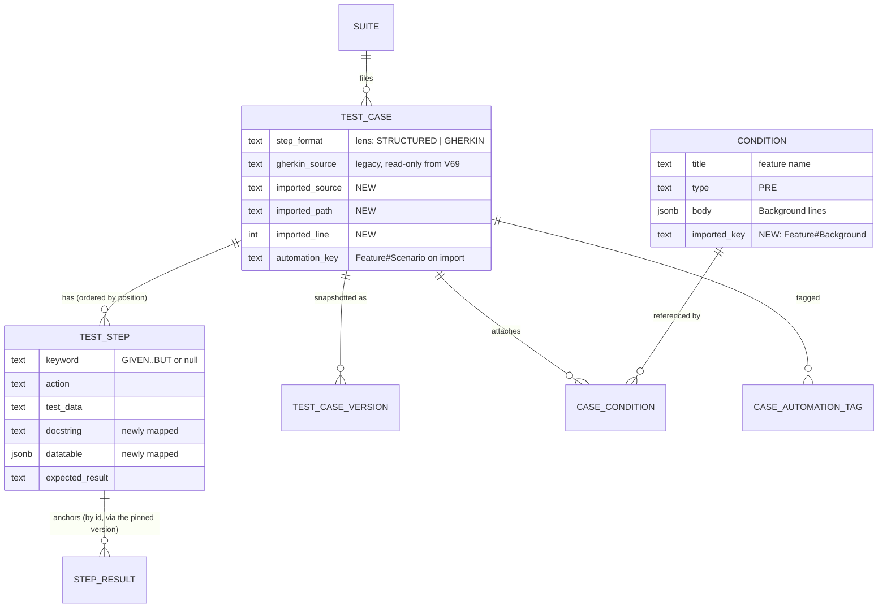
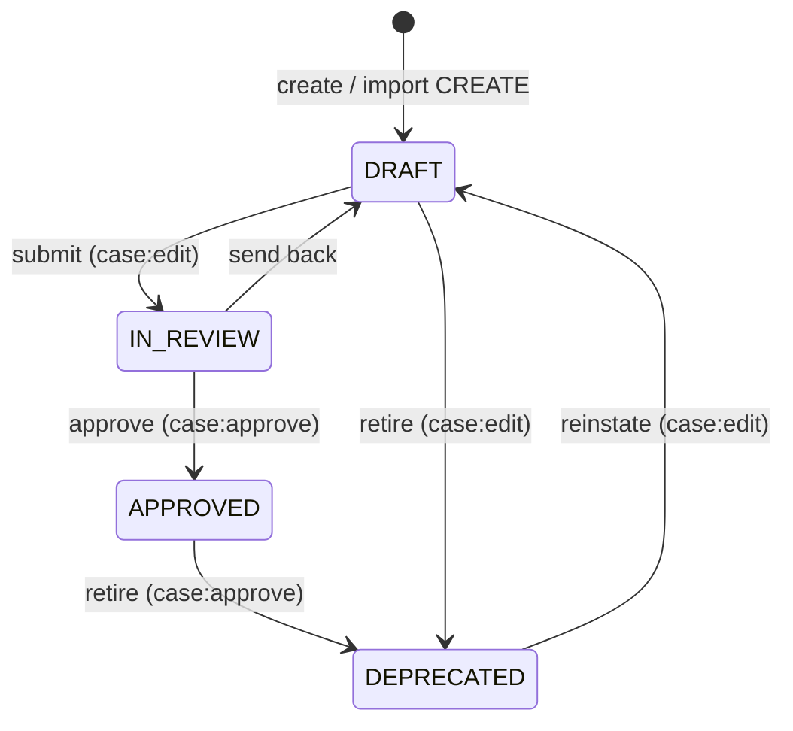

# Unified step model & `.feature` import — Data Model Plan

**Date:** 2026-08-27 · **Written by:** `be-shared-data-model-plan`
**Blueprint:** `./blueprint.md` (approved 2026-08-27)
**Engine:** PostgreSQL 17 (`compose.yaml:32`), Flyway, forced RLS — detected. Head migration `V68`; this initiative takes **`V69`** and nothing else.

This is a **delta** plan over a 64-table schema. Everything not listed here is unchanged; every existing convention wins. Facts read out of the repo are `#observed` with `file:line`; the human's gate decisions are `#confirmed` (blueprint §10a).

## 1. Conventions

| Convention | Choice | Reason |
|---|---|---|
| Primary key | `UUID` v4 assigned in Java (`TestStep.of`: `UUID.randomUUID()`, `TestStep.java:76`) | The project's convention; no generator column. Unchanged `#observed` |
| Tenancy | `company_id UUID NOT NULL REFERENCES company(id)` on every company-owned table, forced RLS keyed on `app.current_company`; `SchemaConventionTest` computes the invariant | ERD §0.1; `docs/specs/tenancy-invariants.md`. No new table here, so nothing new to classify for `export-company` (§246) |
| Enums | stored as `TEXT` with a `CHECK (… IN (…))`; Java enum `@Enumerated(STRING)` | `test_step.keyword` already does it (`V1:598`) |
| JSON | `JSONB`; mapped as a `String` or via an `AttributeConverter`, never a mapped entity graph | `test_case_version.snapshot` is held as a `String` on purpose (`TestCaseVersion.java:73-79`) |
| Soft delete | `deleted_at` on `test_case`, `condition`, `suite` — reads filter it; unique indexes are partial where they must be | Unchanged |
| Concurrency | `lock_version BIGINT` on `test_case` and `condition`; the import goes through the services that honour it | Unchanged |
| Audit | `created_by`/`updated_by` UUID (nullable) on authored rows; `audit_event` rows written by the services | The backfill sets `created_by` on the version to the resolved `--actor` (Q3) and writes **no** `audit_event` (§3, `test_case_version`) |
| Expand–contract | `V69` **adds** only. Nothing is renamed, dropped, or made `NOT NULL` here | Blueprint Q2: contraction is initiative `002-` |
| Naming | `snake_case`, singular table names (`test_step`, `condition`) — the existing schema | — |
| Migrations | One Flyway version per slice, pre-assigned; a migration never needs a company context (ERD: per-company vocabularies are functions, not `INSERT`s) | `docs/specs/parallel-work-rules.md`; it is why C is a command, not a migration |

**Tenancy & isolation:** DB-enforced (RLS) plus the Hibernate `@Filter` on every entity (`TestStep.java:48`). The one app-only boundary this initiative adds is **project narrowing inside a company** for the import's `automationKey` lookup: `test_case_automation_key_idx` is per **company** (`V1:542-543`), so a key hit in a sibling project is visible to the same session and must be turned into a `REFUSE` by the service (blueprint DEC-1 R4). `qa-security`'s cross-project check on that path is owed (blueprint §6).

## 2. Entity catalog

| Entity | Owning area | Purpose | Lifecycle states | Volume / growth | Notes |
|---|---|---|---|---|---|
| `test_step` *(changed)* | A | One step of one case; now carries the Gherkin block arguments on the contract | none — rows are upserted by id (`CaseSteps.java:30-33`) | ~5–15 per case; a Gherkin case that had 0 gains 3–8 on backfill | `docstring`, `datatable` mapped for the first time; one-data check added |
| `test_case` *(changed)* | A, D | The case; stops writing `gherkin_source`, gains import provenance | `DRAFT → IN_REVIEW → APPROVED → DEPRECATED` (`LifecycleStatus.java:45-50`) — unchanged, drawn in §5 because DEC-1 branches on it | unchanged | `imported_source`, `imported_path`, `imported_line` |
| `test_case_version` *(unchanged DDL)* | A, C | The snapshot execution pins | write-once | +1 per backfilled case | Snapshot JSON gains `docString`/`dataTable` per step by virtue of `TestCaseDetailView` gaining them (`CaseVersions.java:152-169`) |
| `condition` *(changed)* | D | Library precondition; **one per distinct Background step** across the project's imported features (Q7) | live / soft-deleted | +1 per distinct Background step text | `imported_key` = text hash, the deterministic re-import match |
| `case_condition` *(unchanged — `detected`)* | A, D | N `PRE` and N `POST` per case, ordered by `position` (`V1:614-630`) | — | +k per imported scenario, k = Background steps | Reference form only (`condition_id`); the import owns the `PRE` rows whose condition has an `imported_key`, and never touches `POST` rows |
| `suite` *(unchanged)* | D | One per imported feature | unchanged | +1 per feature | Created through `SuiteWriteService.create` (`SuiteWriteService.java:221`) |
| `case_automation_tag` *(unchanged)* | D | `@tags` without the `@` | — | a few per case | `PK (case_id, tag)` makes re-import idempotent by construction (`V1:552-557`) |

Every blueprint area owns at least one entity: A → `test_step`/`test_case`; B owns none **and is a cross-cutting parser over A's rows** (stated in the blueprint, not a gap); C → `test_case_version`; D → `condition`, `suite`, `case_automation_tag`.

## 3. Tables

### `test_step` — area A (changed)

Purpose: one step; a keyword and at most one of three data spellings.
Lifecycle: none.

| Column | Type | Null | Default | Constraint / note |
|---|---|---|---|---|
| `id` | uuid | no | — | PK, **stable** — `step_result` FKs it (`V1:606-607`). Unchanged |
| `company_id` | uuid | no | — | FK → `company`. Unchanged |
| `case_id` | uuid | no | — | FK → `test_case` ON DELETE CASCADE. Unchanged |
| `position` | int | no | — | Sibling order; moves on reorder. Unchanged |
| `keyword` | text | yes | — | `CHECK IN ('GIVEN','WHEN','THEN','AND','BUT')`. Unchanged DDL; **now written by the `GHERKIN` lens** (`CaseEdit` rule R1) |
| `action` | text | no | — | The step text. Unchanged |
| `test_data` | text | yes | — | Structured data spelling. Unchanged |
| `expected_result` | text | yes | — | Optional on any row, including a `THEN`. Unchanged |
| `docstring` | text | yes | — | Gherkin `"""` block. **Newly mapped** on `TestStep` as `String` |
| `datatable` | jsonb | yes | — | Gherkin `\|` table as a JSON array of arrays of strings (`[["a","b"],["1","2"]]`). **Newly mapped** via an `AttributeConverter<List<List<String>>, String>`; rows may be ragged — the contract does not require rectangular tables and the parser does not produce non-rectangular ones |
| `shared_step_id` | uuid | yes | — | Dead since §239 (`CaseEdit.java:835`). **Not touched** here; its drop belongs to `002-` with the other contraction |

**Keys & constraints**
- PK `id` (unchanged)
- **NEW `ck_test_step_one_data`:** `CHECK (num_nonnulls(test_data, docstring, datatable) <= 1)` — at most one data spelling per step (blueprint DEC-2 R3 mirrors it in Java so the user gets a field error, not a constraint violation)

**Indexes**
| Index | Columns | Serves |
|---|---|---|
| `test_step_case_idx` | (`case_id`, `position`) | The detail and version reads. Unchanged; no new query needs another |

**Retention:** rows live with their case (cascade). Unchanged.

### `test_case` — areas A, D (changed)

Purpose: the case; this initiative changes which columns are written and adds import provenance.
Lifecycle: `DRAFT → IN_REVIEW → APPROVED → DEPRECATED` with the edit-key moves the roles spec §A3.5 describes — unchanged; §5 draws it because DEC-1 refuses `UPDATE` on `APPROVED`/`DEPRECATED`.

| Column | Type | Null | Default | Constraint / note |
|---|---|---|---|---|
| `step_format` | text | no | `'STRUCTURED'` | `CHECK IN ('STRUCTURED','GHERKIN')` (`V1:498-499`). Unchanged; now a **lens**, not a storage switch |
| `gherkin_source` | text | yes | — | **Unchanged DDL, no longer written by any path in this initiative.** Read by: the SPA fallback (a case with zero `test_step` rows and a non-null blob), the backfill (C), and the `search_vector` generated column (`V2:70-76`). Dropped in `002-` |
| `imported_source` | text | yes | — | **NEW.** The scenario's original text at last import — the `Scenario:` block verbatim, from its first line to the last step. Written only by D; the editor never writes it. **Read** by D's `UPDATE` path: identical text → `SKIP "unchanged since import"` (api-surface §5.4), so the column has a reader in the same task as its writer |
| `imported_path` | text | yes | — | **NEW.** The file path the caller supplied (provenance only; ≤ 1024 chars, checked in Java) |
| `imported_line` | int | yes | — | **NEW.** 1-based line of the `Scenario:` keyword in that file (blueprint A8) |
| `automation_key` | text | yes | — | Unchanged. Import writes `"<Feature name>#<Scenario name>"` (`CucumberReportParser.java:48`) |
| `automation_status` | text | no | — | Unchanged. Import writes `AUTOMATED` (`AutomationStatus.java:16`) |
| `lifecycle_status`, `lock_version`, `deleted_at`, … | | | | Unchanged |

**Keys & constraints** — unchanged. The three new columns carry no constraint of their own: they are either all null (never imported) or all set (imported) and Java writes them together; a CHECK enforcing that triple is deliberately **not** added, because the backfill (C) does not set them and a future partial import must not be blocked by DDL.

**Indexes** — unchanged. The backfill's selection (`step_format = 'GHERKIN' AND gherkin_source IS NOT NULL AND NOT EXISTS (test_step …)`) runs once per company under RLS over that company's rows; no index is owed for a one-time operator pass, and the plan says so rather than adding one.

### `test_case_version` — areas A, C (unchanged DDL)

Purpose: the full resolved snapshot execution pins (`V1:571-585`).

| Column | Change |
|---|---|
| `snapshot` | The JSON is `TestCaseDetailView` serialized (`CaseVersions.java:159-169`). Once that view's step shape carries `docString` and `dataTable` (api-surface §3 `TestStep`), every new snapshot carries them **with no DDL change**. Old snapshots lack the keys; `CaseFacts.PinnedStep` (`CaseFacts.java:256-263`) reads them as absent → null |
| `created_by` | For a backfill-minted version: the user id `--actor=<email>` resolved to (Q3). For an import-minted version: the caller |
| `change_comment` | Backfill writes `"Migrated from gherkin_source by migrate-gherkin-source"`; import writes `"Imported from <path>:<line>"` |

**Concurrency note (C):** a version minted by the backfill bumps `test_case.current_version_no` through the same `CaseVersions` path the editor uses, so drift detection (§M3) sees a real new version — correct, and stated in the command's report.

### `condition` — area D (changed)

Purpose: library precondition; the import's home for each `Background:` **step** (Q7 — one condition per step, not per feature).

| Column | Type | Null | Default | Constraint / note |
|---|---|---|---|---|
| `title` | text | no | — | Import writes the **step text with its keyword** — `"Given a paid order in status PACKED"` (≤ 150 chars per `ConditionInput.title`; longer is truncated at 147 + `…`, the `conditions[]` row says so; the body keeps the full text) |
| `type` | text | no | — | Import writes `'PRE'` (`V1:468`). Never `'POST'`: Gherkin has no postcondition construct |
| `body` | jsonb | no | — | That **one** step as ordered lines: the step line, then its DocString lines or `\|`-table rows indented (`ConditionWriteRequest.body: List<String>`, `ConditionWriteRequest.java:20`) |
| `imported_key` | text | yes | — | **NEW.** `"bg:" + first 16 hex chars of SHA-256` over the normalised step — keyword + text + block lines, whitespace collapsed, line endings `\n`. **A text hash, not a positional key**, so a reordered or partly rewritten Background re-mints nothing, and the **same step text in two features is one condition** for the whole project. Non-null ⇒ "the import owns this entry" |
| everything else | | | | Unchanged |

**Keys & constraints**
- **NEW partial unique index `condition_imported_key_idx`** ON `condition (company_id, project_id, imported_key) WHERE imported_key IS NOT NULL AND deleted_at IS NULL` — project-scoped because a Background belongs to one automation repo. A soft-deleted condition frees its key: the next import re-creates it (`CREATE`). A Background step that disappears from every file leaves its condition **in the library** (never deleted — a human retires it); only the attachments the import owns are removed from the cases it updates.

**Indexes**
| Index | Columns | Serves |
|---|---|---|
| `condition_imported_key_idx` | (`company_id`, `project_id`, `imported_key`) partial | One probe per distinct Background step per request: "is this step already in the library" |

### `case_condition`, `suite`, `case_automation_tag` — area D (unchanged)

- `case_condition` — **N `PRE` and N `POST` per case is the existing model** (`kind`, `position`, `case_condition_case_idx (case_id, kind, position)`, `V1:614-630`; `CaseUpdateRequest.preconditions`/`postconditions`, `CaseUpdateRequest.java:107-108`) — `detected`. The import attaches one `PRE` row per Background step, `position` = its order in the Background (feature's steps first, then a `Rule:`'s), through `CaseUpdateRequest.preconditions` in the reference form, never `inline_body`. **Ownership rule (Q7):** an attachment is *owned by the import* iff its condition's `imported_key` is non-null. On `UPDATE` the import sends `preconditions` = [the file's owned set in Background order] ++ [the case's existing **non-owned** PRE attachments in their existing relative order], so human-attached preconditions survive; it sends `postconditions = null` ("leave them alone", `CaseUpdateRequest.java:78-91` semantics), so **POST attachments are never touched**. On `CREATE` there are no POST attachments to preserve and none are created.
- `suite`: created through `SuiteWriteService.create` with `name` = feature name, `description` = feature description, `tagRules = null`, `idempotencyKey = null` — the service's own key generation and `uq_suite_key` apply (`V1:442`). Match on re-import is **by exact trimmed name among live suites of the project**; two matches → the file is `REFUSE`d (blueprint A3).
- `case_automation_tag`: import writes the union of feature-level and scenario-level tags, without `@`; `PK (case_id, tag)` makes replay a no-op.

## 4. Reference & seed data

| Table | Contents | Owned by | Per-environment? |
|---|---|---|---|
| — | No reference or seed rows are added. `step_keyword` values stay a CHECK, not a lookup table (the enum is closed and app-owned) | — | — |

**Existing data & backfill:**

| Source | Data | Target tables | One-time or sync | Validated by | Delivery task |
|---|---|---|---|---|---|
| `test_case.gherkin_source` on every `GHERKIN` case with zero `test_step` rows | The scenario text (a `Scenario:` block with optional `Feature:`/`Background:` headers, as `GHERKIN_TEMPLATE` seeds it — `CaseEditorPage.tsx:107`) | `test_step` (rows), `test_case_version` (one new version per case) | **One-time, per company, by the operator** (`migrate-gherkin-source --slug=<slug> --actor=<email> [--dry-run]`) | The operator, reading the command's report: migrated count, and the **listed** cases (key, line:col, parser message) that did not parse — those stay on the blob and the SPA fallback | T5 |
| A `Background:` inside a stored blob | Its steps | **not migrated** — the case's text is not a library entry and the backfill has no `library:manage` actor semantics. The Background lines are **listed** in the report per case (`background-skipped`) for a human to attach a precondition by hand | one-time | the operator | T5 |
| `Scenario Outline` inside a stored blob | — | **not migrated**; listed with the reason `Scenario Outline` (plan §6m) | — | the operator | T5 |

Column-level mapping (non-obvious only): a `Feature:` header inside the blob is **ignored** (the case already has a title); a `Scenario:` title in the blob does **not** overwrite `test_case.title` (the case's title is authored; the blob's is a duplicate of it in every template-seeded case); the `# expected:` / `# data:` comment convention the renderer emits (api-surface §5.2) is honoured by the parser so a rendered case parses back to the same rows.

## 5. Diagrams

`test_case` lifecycle (unchanged; drawn because DEC-1 branches on it):

Transitions the **import** may not cause: none — an import never changes `lifecycle_status`. It writes content on `DRAFT`/`IN_REVIEW` only (DEC-1 R6) and reports `APPROVED`/`DEPRECATED` as `SKIP` (R5). These are `SKIP` rows in the plan, not `409`s, by the blueprint's "refusals are rows" rule; api-surface §4 records that as a deliberate departure from the catalog's V5.4.

## 6. Ownership map

Modular monolith — omitted. Every table above is owned by the `repository` module; `execution` reads `test_case_version.snapshot` through `CaseFacts` (`execution/CaseFacts.java:256`), which is the existing edge.

## 7. Migration sequence

| # | Migration | Contains | Depends on | Delivery task | Online-safe? |
|---|---|---|---|---|---|
| 1 | `V69__step_data_and_import_provenance.sql` | `ALTER TABLE test_step ADD CONSTRAINT ck_test_step_one_data CHECK (num_nonnulls(test_data, docstring, datatable) <= 1)` · `ALTER TABLE test_case ADD COLUMN imported_source TEXT, ADD COLUMN imported_path TEXT, ADD COLUMN imported_line INT` · `ALTER TABLE condition ADD COLUMN imported_key TEXT` · `CREATE UNIQUE INDEX condition_imported_key_idx ON condition (company_id, project_id, imported_key) WHERE imported_key IS NOT NULL AND deleted_at IS NULL` · `COMMENT ON` each, carrying the *why* as V1 does | `V68` | **T1** | Yes — additive nullable columns and a CHECK that is trivially true on every existing row (`docstring`/`datatable` have never been written; `test_data` alone satisfies `<= 1`). The CHECK is added **with validation** (not `NOT VALID`) because the table is small enough per instance and the scan proves the premise |

**Not in this initiative — `002-`'s migration (`V70`), recorded so it cannot be missed:** drop `test_case.gherkin_source` after re-creating the `search_vector` generated column (`V2:70-76`) and its GIN index without it; drop `test_step.shared_step_id`; drop `case_condition.inline_body` and its CHECK. **Gate:** `migrate-gherkin-source` has been run on every deployed instance and its report shows zero cases left on the blob.

The `num_nonnulls` function exists on PostgreSQL ≥ 9.6 — available on 17; no version concern.

## 8. Open questions & deferrals

| # | Question | Blocks | Owner |
|---|---|---|---|
| D1 | Should `imported_source` be added to the `search_vector` expression in `002-` (it duplicates step text that is deliberately excluded — `V2:63`)? | nothing in `001` | `002-` planner |
| D2 | A condition title longer than 150 chars is truncated by the import (§3 `condition`). Is truncation acceptable, or should such a feature be `REFUSE`d? | nothing — truncation stands as the assumption until overruled | the human, any time before T6 |

## 9. Routed to `data-architect`

| Decision | Why it needs depth |
|---|---|
| none | Every change is an additive column, one CHECK, and one partial unique index in the shape the schema already uses. No index needs plan analysis (the backfill is a one-time operator pass; the condition key probe is a point lookup) |
