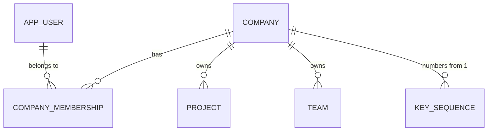
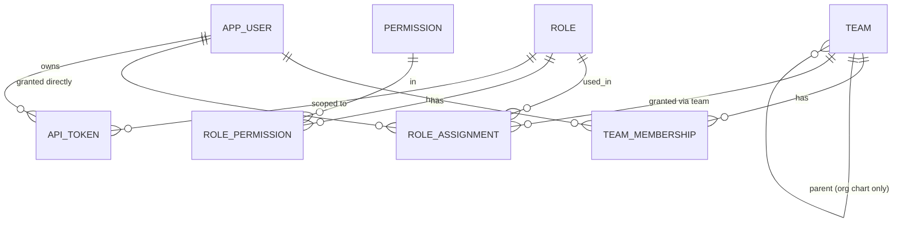
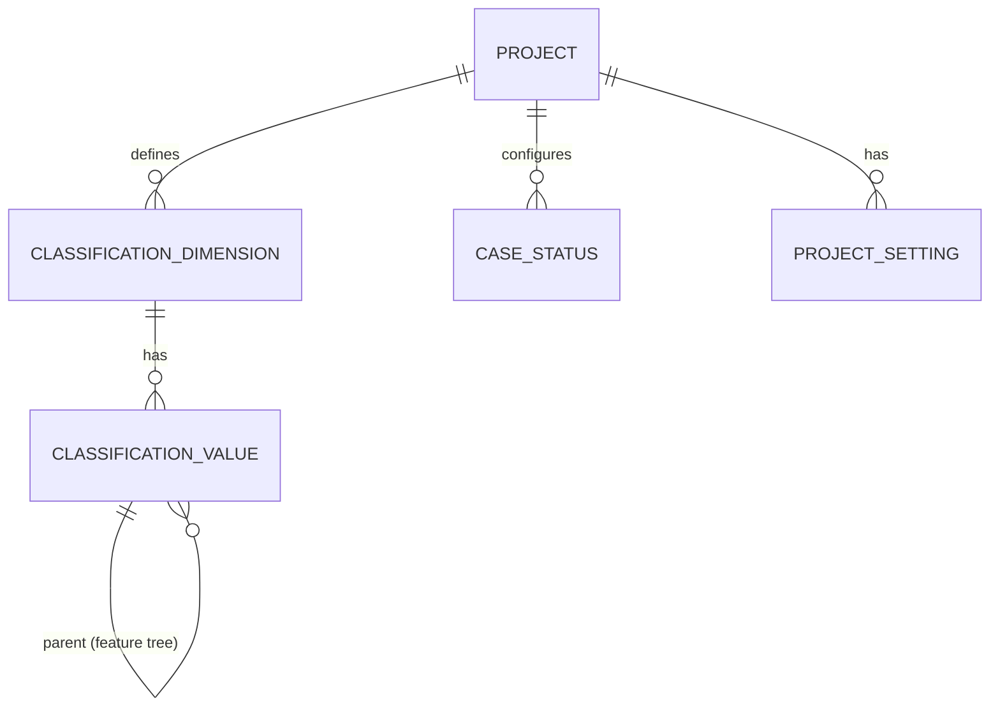
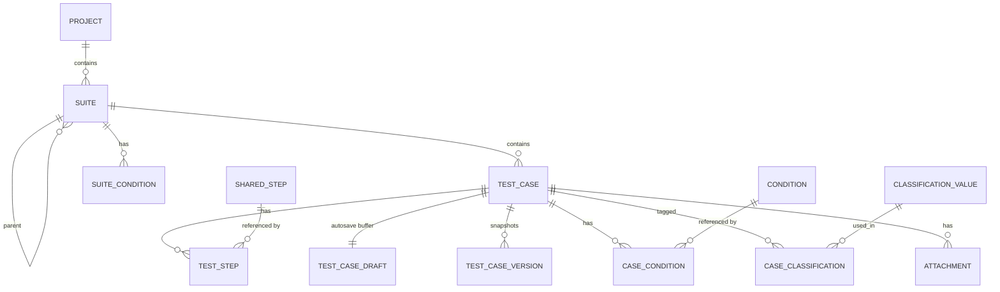
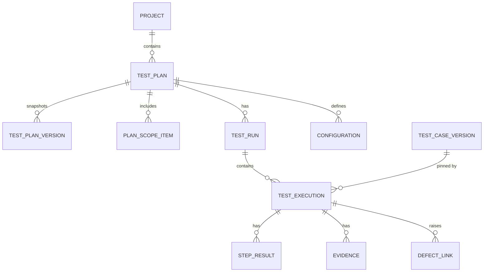
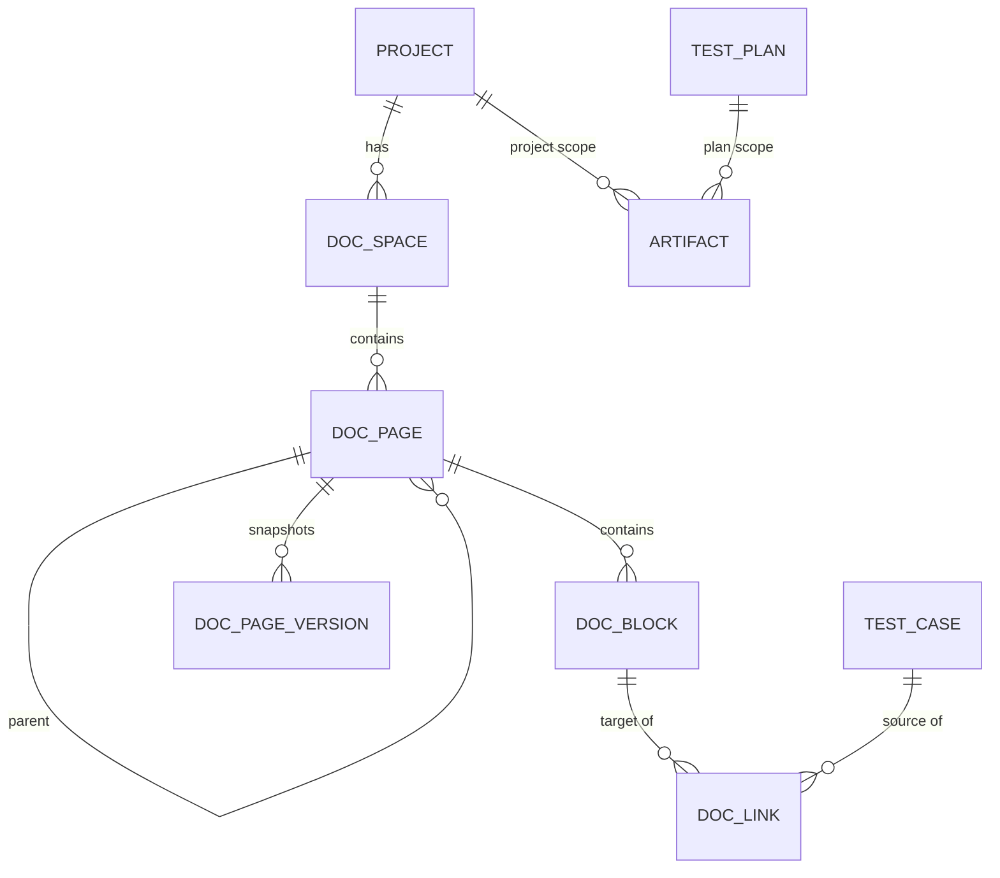

# TCMS — Entity Relationship Design

**Status:** Revised 2026-07-30 for multi-company · DDL regenerated and statically validated · ~~not yet executed against Postgres~~ → **executed 2026-08-01 against a live Postgres 17.10** (V1–V18, all `installed_by=tcms_owner`), and the RLS properties verified on that box rather than only in Testcontainers — see the Hetzner runbook §13
**Date:** 2026-07-30
**Companions:**
- `docs/plans/2026-07-30-tcms-high-level-plan.md` — § references throughout point there
- `docs/specs/2026-07-30-tcms-roles-permissions-naming.md` — **authoritative** for the permission catalogue, role grants and naming conventions; this document defers to it wherever they overlap

**DDL:** `backend/src/main/resources/db/migration/V1__initial_schema.sql` — **regenerated from this revision**, 63 tables. §11 records what validation has and has not been done.

> **2026-08-29 — the migration chain was collapsed.** V2–V75 were absorbed back into `V1__initial_schema.sql` and deleted, so that file is now the whole schema as it stands: **87 tables, 74 under `FORCE ROW LEVEL SECURITY`**, plus the functions, the triggers and the reference data. The numbers in this document describe the 2026-07-30 revision and are left as written. The collapse was verified by building one database from the old chain and one from the new file and diffing `pg_dump` of both — schema and seed data identical. Consequence: V1 only ever runs on an **empty** database, and the next migration is **`V2`**.

---

## 0. Conventions

Applied to every table unless explicitly noted.

| Convention | Rule |
|---|---|
| **Primary keys** | `UUID` (v7 — time-ordered, so index locality is preserved). Generated application-side. |
| **Company** | `company_id UUID NOT NULL` on every company-owned table, leading every composite index and every previously-global uniqueness constraint. See §0.1 for the full rule and the exception list. |
| **Audit columns** | `created_at`, `created_by`, `updated_at`, `updated_by` on all mutable entities. |
| **Soft delete** | `deleted_at TIMESTAMPTZ NULL` on user-authored content. Partial indexes use `WHERE deleted_at IS NULL`. |
| **Optimistic locking** | `lock_version BIGINT NOT NULL DEFAULT 0` on concurrently-edited entities (`@Version`). |
| **Timestamps** | `TIMESTAMPTZ` always. Never naive local time. |
| **Enums** | Postgres-side `CHECK` constraints over `TEXT`, not native `ENUM` types — native enums cannot have values removed and every migration becomes painful. |
| **Naming** | `snake_case`, singular table names, `<table>_<column>_idx` for indexes, `fk_<table>_<target>` for FKs. |
| **JSONB** | Used only for version snapshots and CI raw payloads. Not for live queryable state. |

### 0.1 The `company_id` rule

**This is no longer a hedge.** Multiple companies per instance is in scope, where a **company is a separate client** (plan §1, §6s). The feature ships last (M6), but the discriminator ships in M0 because retrofitting it across every table, index and uniqueness constraint is the most expensive change available in this project.

Four things, all mandatory:

1. **`company_id UUID NOT NULL` on every company-owned table** — including join tables, version tables, audit events, read models and the raw CI payload store. A **schema test** asserts this over every table not on the exception list, so a new table fails the build until it complies. That test is the only mechanism that survives a year of feature work.

   **Join tables and version tables are where this is actually forgotten** — and the first DDL pass proved it. Regenerating `V1` and cross-checking found five join tables written without `company_id` (`case_classification`, `case_tag`, `case_automation_tag`, `case_condition_optout`, `work_item_link`) and four version/annotation tables absent from the RLS list (`suite_version`, `test_plan_version`, `doc_page_version`, `derived_item_annotation`). Both classes matter more than they look: a join table without the column is unfilterable *and* un-RLS-able, so a query starting from `case_classification` could cross clients; and a version table holds a full historical snapshot of client content, so an unprotected one is a complete read of another client's test assets. Neither was visible by reading the schema top to bottom — only by mechanically comparing every table against the rule. **The schema test is therefore not optional and not a formality.**
2. **A globally-applied Hibernate filter** (`@FilterDef` + `@Filter`) enabled per session from a request-scoped `CompanyContext`, populated from the authenticated session — **never** from a request parameter, header or path segment. The path carries the company slug for readable URLs and is *validated against* the session, not trusted as its source.
3. **`company_id` leads every composite index** and every uniqueness constraint that was previously global: `project.key`, `team.name`, `api_token.name`, `test_case.automation_key`, `key_sequence`, `project_key_sequence` (`V2`), and company-scoped classification values. Leading, not appended — otherwise the column costs storage and buys nothing at query time.
4. **Postgres RLS enabled by default** — policies on `company_id`, with the application setting `app.current_company` once per transaction (`SET LOCAL`). Because companies are separate clients, this is the difference between "our filter is correct" and "the database will not serve another client's rows even if the application forgets." Documented as disableable for the performance-sensitive; the shipped default is on.

   **Three things make RLS a real guarantee rather than a decorative one**, all in the `V1` DDL and none verifiable by static analysis:

   - **`FORCE ROW LEVEL SECURITY`, not just `ENABLE`.** A table's *owner* bypasses RLS under plain `ENABLE`. If the application connects as the role that owns the schema — which is the default in most compose setups — plain `ENABLE` protects nothing. The app role must also not hold `BYPASSRLS`.
   - **An unset GUC must yield zero rows, not all rows.** The policy uses `current_setting('app.current_company', true)::uuid`, where the `true` makes a missing setting return NULL rather than raising; `company_id = NULL` is never true, so a request that forgot to establish company context sees nothing. **This failure mode is silent and inverted** — get the `true` flag or the comparison wrong and a context-less query returns the whole instance. It needs its own explicit test, not just a passing suite.
   - **The migration fails loudly if the policy list drifts.** The `DO $$` block raises when the list names a table that doesn't exist, so a rename can't silently drop a table's protection. The reverse direction — a *new* table missing from the list — is what the schema test in point 1 covers.

**A fifth thing the rule does NOT buy, recorded here because §0.1 is where a reader looks for it: `company_id` is not referential integrity.** Five columns in this schema point at a row of a kind chosen by a sibling discriminator column and carry **no foreign key** — `attachment.owner_id` (`owner_type`), `doc_link.source_id` (`source_type`), `review.subject_id` (`subject_type`), `issue_link.target_id` (`target_type`, `work_item_link`'s successor since `V4` dropped that table) and, since `V9`, **`time_entry.subject_id` (`subject_type`)**. The first is one table instead of six (§4); the rest are §0.2's module rule — ArchUnit permits a cross-module dependency only toward the five foundation modules, `tracker` is not one and will never be one, so a module downstream of an issue holds an id and keeps its own projection.

**The cost is the same one every time and it is worth naming rather than implying: the database will not stop the pointed-at row being deleted.** A deleted issue can orphan a `time_entry`, exactly as it can an `issue_link` edge — integrity between them is enforced in application code, and nothing in Postgres will notice when it is not. RLS still holds on both sides (`company_id` is `NOT NULL` and policed on every one of these tables), so an orphan is a *dangling* row, never a *cross-client* one. The mitigation is soft delete — `issue_fact.deleted_at` mirrors `issue.deleted_at` rather than the row being removed, so a period already reported on does not change when somebody tidies the backlog — plus the nightly consistency check. A real FK is used wherever the target is a foundation module's: `time_entry.project_id` is one, and §7a point 3 makes the same distinction for `test_run.release_id` from the other direction.

**Deliberate instance-level tables (no `company_id`)** — this list is the schema test's exception list, and nothing may be added to it without a decision:

| Table | Why |
|---|---|
| `company` | It *is* the company |
| `app_user` | One identity may belong to several companies (§1) |
| `permission` | The catalogue is instance-wide reference data |
| `role` | Built-in roles are seeded once; there are no custom roles in v1 |
| `role_permission` | Join between two instance-level tables — both sides are instance-wide reference data, so a `company_id` on it would be meaningless |
| `instance_role_assignment` | `SYSTEM`-scope grants. See §2 for why these are a separate table rather than a NULL `company_id` on `role_assignment` |
| `flyway_schema_history` | Infrastructure |
| `instance_setting` | Infrastructure |
| `instance_audit_event` | Operator actions across companies. Carries a **nullable** `company_id` for correlation, but is not RLS-protected — the operator trail spans clients by definition |
| `api_token_lookup` | **Decided in `V36`.** The same decision as `membership_invitation` below, one credential over: an API token is presented *before* authentication, so "which company issued this digest" must be answerable with no context open, and under RLS it returns zero rows — `V7`'s defect, which was invisible to a suite migrating as a superuser. `V8`'s own closing paragraph names this answer in advance ("an instance-level index of the membership fact, not a bypass"). Carries a **non-nullable** `company_id` as a *target*, and holds a digest, a token id and nothing else — no name, owner, role or project. The lifecycle (`expires_at`, `revoked_at`) stays on the RLS-protected `api_token` row and is checked *after* the context is open, so revocation is enforced inside the boundary. **The cost, accepted:** "this digest belongs to this company" sits outside it. The rejected alternative is `V6`'s: encoding the company id into the token string, which makes request input select the tenancy |
| `membership_invitation` | **Decided in `V6`.** Redeemed *before* authentication, so there is no session to resolve a company from — and `CompanyContext` is never populated from request input. Under RLS the row would be permanently unreachable, the same shape as the `role_assignment.company_id IS NULL` defect in §2. Carries a **non-nullable** `company_id` as the company it admits the holder *to* — a target, like `instance_audit_event`'s, not a discriminator. **The cost, accepted:** "this user was invited to this company" sits outside the isolation boundary. Mitigated in the DDL — no email, no name, only a SHA-256 of the token, and rows are consumed then purgeable. The rejected alternative was encoding the company id into the token so the accept path could open a context first: it keeps this list closed and it makes request input select the tenancy, which is the one thing that must never be negotiable |
| `sso_login_attempt` | **Decided in `V53`.** The same decision as `membership_invitation` and `api_token_lookup`, one credential over: an OIDC callback arrives *before* authentication, so the `state` it carries must be resolvable with no context open, and under RLS it returns zero rows — `V7`'s defect. Carries a **non-nullable** `company_id` as the company the attempt is *against* — a target, like `api_token_lookup`'s, not a discriminator. Holds a SHA-256 of the `state`, the PKCE verifier, the nonce, the provider id and an expiry, and **nothing identifying**: no email, no subject, no user id, because at insert time none of them are known yet. Rows are single-use and expire in 10 minutes, so the table is empty in steady state. The rejected alternative was a signed cookie carrying the verifier, which puts a confidential client's PKCE secret in the browser and keeps the `state`/`nonce` replay check client-side, where it is not a check |
| `user_social_identity` | **Decided in `V58`** (the 2026-08-16 social-login plan). A person's social identity (GitHub/GitLab/Google) is theirs across every company they belong to — a company-scoped copy per membership would need `V53`-style RLS gymnastics for no isolation gain, since the login path reads this table *before* any company context can exist. The key is `(provider, subject)`, never email — `user_identity`'s rule, same reason. Holds the subject, an `email_at_link` recorded as provenance only, and timestamps; rows are created by explicit linking from the security page, never during account creation |
| `social_login_attempt` | **Decided in `V58`.** `sso_login_attempt`'s twin for the instance-level social providers: consulted before any session exists, pre-context by construction. No `company_id` at all — there is no company until somebody signs in, and the providers themselves are instance configuration rather than `identity_provider` rows. Carries the intent (`LOGIN`/`LINK`) server-side, bound to the hashed `state`, so the callback URL never says what completing it may do; a `LINK` row alone carries a `user_id`, enforced by a shape check. Single-use via `consumed_at`, expiring, empty in steady state |

Two of these were **found by executing the schema rather than reading it** (`docs/audits/2026-07-30-v1-schema-first-execution.md`). `role_permission` was absent from this list while absent from the DDL's `company_id` set too — so the schema test as specified would have failed the build on its first run, and the tempting repair is to add a meaningless `company_id` rather than correct the list. This is §0.1's own argument recurring: the invariant needs computing, not asserting.

**Isolation is proven, not assumed.** From M0, CI runs a paired-fixture suite: two companies provisioned with deliberately identical-looking data (same project key, same display keys, same team names, the same user email as a member of both), then every read endpoint exercised as company A asserting no company-B row, name, id or count appears. Plus a third persona — a company member with **no project grant** — asserting they see nothing, since those rows *are* in the caller's company and the cross-company assertions structurally cannot catch that leak.

### 0.2 Module boundaries

Tables are grouped by Spring Modulith module (§5). Cross-module FKs are permitted only toward `tenancy`, `identity`, `project` and — since 2026-08-07 (§125, decision #51) — `storage`; everything else crosses via domain events. This is enforced by ArchUnit, not convention.

```
tenancy · identity · project · storage · repository · execution · documentation · reporting · work · shared
```

`storage` owns exactly one table, `attachment`, and it is the fourth permitted FK target for one reason: `execution` and `reporting` both need blob bytes back **synchronously, inside a request**, and a download cannot be a domain event. It depends on `tenancy` alone and holds no domain concept — an `owner_id` is a UUID it never resolves — which is what keeps the edge inward-only.

`tenancy` is depended on by everything and depends on nothing. A domain event carries the `companyId` of its origin, and an async handler **re-establishes `CompanyContext` from the event envelope** rather than inheriting a thread-local that may have been recycled — context loss across an `@Async` boundary is the realistic way a multi-company instance leaks, and it is invisible in synchronous tests.

---

## 1. Tenancy (`tenancy`)



### `company`
| Column | Type | Notes |
|---|---|---|
| `id` | UUID PK | |
| `slug` | TEXT NOT NULL | **Unique instance-wide, immutable.** In every URL (`/c/{slug}`, `/{slug}/login`) and every shared link. Lowercase kebab. |
| `display_name` | TEXT NOT NULL | Freely editable — clients rebrand more often than they change identifier |
| `status` | TEXT NOT NULL | `ACTIVE · SUSPENDED`. **Honored in code**, not decorative: `SUSPENDED` refuses all non-Instance-Admin access and returns 503 from ingestion with a reason. No `ARCHIVED` state — suspend covers it, and one fewer state is one fewer thing to get wrong in the permission evaluator. |
| `logo_storage_key` | TEXT NULL | §6u |
| `brand_primary_color`, `brand_accent_color` | TEXT NULL | Two colours only. The MUI theme is *derived* from them with contrast-safe foregrounds computed and **validated at save time** — a client-chosen accent is exactly how the WCAG AA commitment breaks silently. Semantic status colours (Pass/Fail/Blocked) are deliberately **not** brandable. |
| `favicon_emoji` | TEXT NULL | |
| `storage_quota_bytes` | BIGINT NULL | Null ⇒ unlimited. Soft warning + hard stop on attachment upload. |
| `settings` | JSONB | Per-company policy: review gating, edit-after-approval mode, health-signal thresholds |

**Provisioned by an operator script, not a UI** (§6s). `provision-company` is a tested, idempotent CLI command that creates the company, seeds its built-in role assignments, classification vocabularies, execution statuses and default settings, creates the first Company Admin as an invitation, and writes an instance audit event. Seeds are **copied in**, never referenced across companies, so a client's later edits are their own.

**Default lifecycle policy is suspend, never delete.** Deletion, if ever required, is a scripted export followed by a scripted purge across every table plus the `company/{id}/` storage prefix — never hand-run SQL against ~60 tables of cascades.

### `company_membership`
| Column | Type | Notes |
|---|---|---|
| `company_id`, `user_id` | UUID FK | Composite PK |
| `display_name` | TEXT NOT NULL | **Per-membership, not global** (§6u) — a contractor may be "A. Kotrulev" in one client and "Aleks (Vendor)" in another, and neither client can see or overwrite the other's |
| `avatar_url` | TEXT NULL | Also per-membership |
| `status` | TEXT NOT NULL | `INVITED · ACTIVE · REMOVED` |
| `invited_by`, `invited_at`, `accepted_at` | | |

**Membership is a precondition for every permission, not a source of any** (§6b). A non-member resolves to the empty permission set regardless of stale grants, so removing someone from a client is a single row update rather than a hunt through per-project assignments. It is the one place the permission model is not a pure union, and that asymmetry is deliberate: it makes offboarding provable.

**Accepting an invitation grants Viewer with no project access.** Same default for SSO JIT provisioning — SSO must not be a side door to more capability than the invite flow grants.

**Every rendering site resolves a person's name through the active company's membership** — assignee pickers, mentions, execution history, audit entries, review comments, report author lines, org chart, kanban avatars. This is why it is in M0: it's a resolution rule threaded through every surface that shows a person, and retrofitting means auditing all of them. Historical records render the name as snapshotted where the audit trail already captures it (§6j), current membership name otherwise — never retroactively rewritten.

---

## 2. Identity & Access (`identity`)



### `app_user` — **instance-level, no `company_id`**
| Column | Type | Notes |
|---|---|---|
| `id` | UUID PK | |
| `email` | TEXT NOT NULL | **Unique instance-wide**, citext-style lower-cased |
| `canonical_name` | TEXT NOT NULL | For the Instance Admin's directory only. **User-facing names come from `company_membership.display_name`** (§6u). |
| `password_hash` | TEXT NULL | Nullable from V1 so SSO-only users are possible in M4 without a schema change. A non-null hash means local login works — the break-glass Instance Admin must always have one (§6r). |
| `status` | TEXT NOT NULL | `ACTIVE · INVITED · DEACTIVATED` |
| `locale`, `timezone` | TEXT NULL | |
| `last_login_at` | TIMESTAMPTZ NULL | |

`UNIQUE (lower(email))` — instance-wide, because **one account may belong to several companies with independent permissions in each** (plan §6s). The alternative (a user row per company, email unique per company) is simpler and was rejected on the requirement: it makes the same person in two clients two unrelated accounts with two passwords and two audit identities.

**The disclosure consequence, and its mitigations** — an instance-unique email means one client's admin could otherwise discover that an address already exists:

- The invite flow **never** reports whether the address is already a user. Always "invitation sent". An existing user receives "you've been invited to Acme" and accepts in-product; a new one gets a signup link. Identical response.
- A user's company list is theirs alone. No admin below Instance Admin can see which other companies a user belongs to.
- Display names are per-membership (above), so one client cannot learn how another labels a person.

Users are never hard-deleted — `DEACTIVATED` preserves authorship (§6j), which is also how an IdP-removed user is handled.

### `identity_provider` / `user_identity` / `claim_role_mapping` — **M4, not V1**

The federation seam (§6r). **Not in `V1__initial_schema.sql`** — external identity ships with the integrations phase, and these tables arrive in that migration. Documented here so the shape is agreed in advance and phase 1 doesn't accidentally block it.

**Why deferring is safe:** every table anchors on `app_user.id` (UUID) with `email` as an ordinary unique column and `created_by` FKs pointing at the user row. Adding these three tables plus `role_assignment.source` is purely additive — backfill one `local` identity row per existing user and nothing else moves.

**The one constraint V1 must honour:** never key identity on email, and never let `created_by` reference anything but `app_user.id`. Both already hold.

**Identity is `(provider, subject)`, never email** — emails change and get reassigned; the IdP `sub` is the only stable key.

**Shipped:** `V53` created these tables and the OIDC lane (§217); **`V57` made `identity_provider` serve two kinds** (§223). An LDAP row has no relying party, so `client_id` lost `NOT NULL` — and because a dropped `NOT NULL` is dropped for the OIDC rows too, `ck_identity_provider_shape` replaces it *conditionally on `kind`*: an OIDC row must carry `client_id` and no search columns, an LDAP row must carry `user_search_base` / `user_search_filter` / `user_id_attribute` and no `client_id`. Eight nullable directory columns were added to the same table rather than a sibling `ldap_identity_provider` — the company scoping, RLS policy, CRUD, audit and discovery are identical for both kinds, and a second table would make "which providers does this domain reach" a union. **`user_identity` is unchanged by `V57`** — `(provider, subject)` carries a directory identifier (`objectGUID` / `entryUUID`, never a DN) exactly as well as it carries an OIDC `sub`, which is what made the identity half of the LDAP slice free.

| `identity_provider` | Type | Notes |
|---|---|---|
| `key` | TEXT | `local · cognito · entra · google · okta · keycloak · oidc-custom` |
| `kind` | TEXT | `LOCAL · OIDC · SAML` |
| `display_name` | TEXT | Rendered on the login button |
| `issuer_uri`, `client_id` | TEXT | Discovery-driven |
| `client_secret_encrypted` | BYTEA | Never plaintext, never logged |
| `jit_provisioning` | BOOLEAN | Create the user on first login, or require an invitation (default: require) |
| `auto_link_verified_email` | BOOLEAN | Link to an existing user when the IdP reports the email verified. **Never on unverified email** — account-takeover vector |
| `group_claim` | TEXT | `cognito:groups` · `groups` · `roles` — varies per provider |
| `enabled` | BOOLEAN | |

| `user_identity` | Type | Notes |
|---|---|---|
| `user_id` | UUID FK | One user may hold several identities (local + Entra during migration) |
| `provider_id` | UUID FK | |
| `subject` | TEXT | The IdP `sub`. `UNIQUE (provider_id, subject)` — **the real identity key** |
| `email_at_link`, `linked_at`, `last_login_at` | | `email_at_link` is a record, not a key |

| `claim_role_mapping` | Type | Notes |
|---|---|---|
| `provider_id` | UUID FK | |
| `claim_name`, `claim_value` | TEXT | Match on the immutable identifier (Entra sends GUIDs, not names) |
| `claim_value_label` | TEXT | Human label for display only |
| `role_id` / `team_id` | UUID FK | Maps to a **role or team, never directly to permissions** (§6b invariant) |
| `project_id` | UUID NULL | Null ⇒ SYSTEM scope |

`role_assignment` gains **`source`** (`LOCAL · IDP`) and `provider_id`. IdP-derived grants are **read-only in the UI** — otherwise an admin edits a grant the next login silently overwrites. Unmapped claims grant nothing: fail closed.

### `integration_credential` — **M4, not V1**

Deliberately separate from user sessions — a Jira token has a different scope, consent model and lifetime than a login (§6r).

`project_id`, `integration` (`JIRA · SLACK · TEAMS · GITHUB · GITLAB · SMTP`), `mode` (`SERVICE · PER_USER`), `user_id` (null for service mode), `access_token_encrypted`, `refresh_token_encrypted`, `expires_at`, `scopes`, `last_refreshed_at`, `last_error`.

`last_error` + `expires_at` exist so project settings can surface credential health: an expired Jira token that silently stops creating defects — while runs keep passing and failing — is the realistic failure and is invisible otherwise.

### `team`
| Column | Type | Notes |
|---|---|---|
| `id` | UUID PK | |
| `company_id` | UUID NOT NULL | Teams never span companies |
| `parent_team_id` | UUID NULL FK → team | **Org chart structure only — no permission cascade** (§6k) |
| `name` | TEXT NOT NULL | `UNIQUE (company_id, name)` |
| `description` | TEXT NULL | |
| `notification_channel` | JSONB NULL | Slack/Teams webhook config (§6b) |

Cycle prevention on `parent_team_id` is enforced in the service layer *and* by a recursive-CTE check constraint trigger. A cycle here breaks the org chart render and any future recursive query. The same trigger validates that **parent and child share a `company_id`** — nesting is confined to one company.

### `team_membership`
| Column | Type | Notes |
|---|---|---|
| `team_id`, `user_id` | UUID FK | Composite PK with `company_id` |
| `is_lead` | BOOLEAN NOT NULL DEFAULT false | **Team Lead** — distinct from the Test Lead *role* (§6b) |
| `joined_at` | TIMESTAMPTZ | |

A user may lead any number of teams; a team may have several leads.

### `role`, `permission`, `role_permission` — **instance-level, no `company_id`**
| `role` column | Type | Notes |
|---|---|---|
| `id` | UUID PK | |
| `scope` | TEXT NOT NULL | `SYSTEM · COMPANY · PROJECT` |
| `name` | TEXT NOT NULL | |
| `built_in` | BOOLEAN NOT NULL | Always true in v1 — see below |

~~**The six built-ins are the complete role set in v1**~~ → **nine since `V2` (2026-08-30): Project Manager, Account Manager and Finance join them, and there are still no custom roles, not even clone-and-edit.** So `role` has no `company_id` and needs none. A client wanting something between two tiers gets the higher one, or the built-in boundary is drawn wrong and should be fixed. Enforcement is permission-based throughout (nothing in the code checks a role *name*), so adding a designer later is additive: `built_in = false` rows plus a `company_id` column, no change to the evaluator. When that lands, custom roles **must** be company-owned — a client editing "Test Engineer" must never mutate a row another client reads.

Seeded by migration:

| Role | Scope |
|---|---|
| **Instance Admin** | `SYSTEM` |
| **Company Admin** | `COMPANY` |
| **Test Lead** | `PROJECT` |
| **Test Engineer** | `PROJECT` |
| **Automation Service** | `PROJECT` |
| **Viewer** | `PROJECT` |

`permission` is a seeded reference table keyed by string (`case:edit`), never referenced by name in code paths other than the check itself. The catalogue and per-role grants are specified in **`docs/specs/2026-07-30-tcms-roles-permissions-naming.md`**, which is authoritative for the seed migration. Notable shapes it fixes:

- `suite:delete` is separate from `suite:manage` (Lead+) — deleting a subtree is the most destructive repository action.
- `project:audit` (Lead+) is separate from `audit:view` (company-wide) — without it a Test Lead could not read their own project's history.
- `case:comment` (Viewer+) sits below `*:review` (Test Engineer+) below `*:approve` (Lead+) — three review tiers, so a client stakeholder can comment without any write access.
- `case:delete` and `evidence:delete` are `OWN`-qualified for Test Engineer, resolved against `created_by` — **not** modelled as separate `case:delete:own` permissions.
- `report:export` is granted wherever `report:view` is, Viewer included.
- `defect:create`, `workitem:manage` and `library:manage` are all Test Engineer+. Library edits are gated by an **impact-confirmation modal** listing affected cases, not by role — informed consent, since the editor is the person who knows whether the change is right.

### `role_assignment` / `instance_role_assignment` — the only source of any capability

Grants live in **two** tables, split by scope. `role_assignment` holds `COMPANY` and `PROJECT` scope and is company-owned like everything else; `instance_role_assignment` holds `SYSTEM` scope and is instance-level.

#### `role_assignment` — `COMPANY` and `PROJECT` scope
| Column | Type | Notes |
|---|---|---|
| `id` | UUID PK | |
| `company_id` | UUID **NOT NULL** | No special case for the schema test |
| `role_id` | UUID FK NOT NULL | |
| `user_id` | UUID FK NULL | Exactly one of `user_id` / `team_id` is non-null |
| `team_id` | UUID FK NULL | |
| `project_id` | UUID FK NULL | Non-null ⇒ `PROJECT` scope; null ⇒ `COMPANY` scope |
| `granted_by`, `granted_at` | | Audited (§6j) |

```sql
CHECK ((user_id IS NULL) <> (team_id IS NULL))
```

The former `CHECK (project_id IS NULL OR company_id IS NOT NULL)` is gone — `company_id NOT NULL` subsumes it.

#### `instance_role_assignment` — `SYSTEM` scope
| Column | Type | Notes |
|---|---|---|
| `id` | UUID PK | |
| `role_id` | UUID FK NOT NULL | |
| `user_id` | UUID FK **NOT NULL** | **Users only — deliberately no `team_id`** |
| `granted_by`, `granted_at` | | Audited (§6j) |
| | | `UNIQUE (user_id, role_id)` |

No `company_id`, no RLS — it is on the §0.1 exception list.

**Why a separate table rather than `company_id IS NULL` on `role_assignment`.** The RLS policy is `company_id = current_setting('app.current_company', true)::uuid`, and `NULL = anything` is never true — so a SYSTEM grant modelled as a NULL `company_id` is invisible in **every** company context, permanently. Instance Admin then resolves to zero permissions, which presents as an authorization bug rather than a schema one, and the tempting repair is `BYPASSRLS` on the app role, which destroys isolation for all 56 protected tables. Widening that one policy to admit NULLs is not the fix either: a context-less query would then return rows, breaking the "unset GUC yields zero rows" invariant in §0.1. Carrying grants in the JWT (§6b) does not avoid it, because login still has to read the grants to mint the token.

This was **measured on the first real execution of `V1`**, not reasoned about — see `docs/audits/2026-07-30-v1-schema-first-execution.md`. The split also removes the last nullable `company_id` under RLS, so the schema-test rule holds uniformly.

**No `team_id` on the instance table** is a second deliberate narrowing: a team is company-owned, so a SYSTEM-scope grant to a team would let a client-controlled entity confer operator rights — an escalation path whose membership the client administers. Instance Admin is granted per person by the operator (§6s).

**Effective permissions:**

```
effective(user, project) =
    ∅  unless user has an ACTIVE company_membership for project.company   ← gate, not a union term
      ⋃ roles granted directly to user on project
    ⋃ ⋃ roles granted to any team the user belongs to, on project
    ⋃ ⋃ roles granted to user or their teams on project.company   (COMPANY scope)
    ⋃ ⋃ roles granted to user at SYSTEM scope                     ← instance_role_assignment
```

Cached per `(company_id, user_id, project_id)` — **the company id must be in the cache key**; invalidated on any write to `role_assignment`, `instance_role_assignment`, `team_membership`, `role_permission` or `company_membership`, and on a company switch. No explicit deny anywhere in the model — deliberate (§6b).

**A `COMPANY`-scope grant covers every project in that company, present and future.** That is what makes Company Admin work: a client's own administrator sees every one of their projects with no per-project grant, which would otherwise be indefensible. It is also why nothing else should be granted at that scope casually.

**Company scoping is prior to, and independent of, permission scoping.** The `company_id` filter removes foreign rows from existence; the permission check then decides what may be done with what remains. A permission bug inside a company is privilege escalation; a filter bug across companies is a data breach. They get independent defences, and a missing `@PreAuthorize` must never be the only thing between two clients.

### `api_token`
`company_id` (**bound at issue time — the request path must match or the call is rejected**), `token_hash` (never the token), `role_id` (a token carries a role, **not** the issuing user's rights — §6b), `expires_at`, `last_used_at`, `revoked_at`. Tokens are actors in `audit_event`.

A CI token holds **Automation Service** and nothing more — `case:read`, `run:create`, `result:submit`, `evidence:attach`, and `case:create` restricted to the quarantine folder. Deliberately the smallest role in the product: a leaked token can post results and add quarantine stubs, and cannot edit or delete a real case, close a run, read reports, or reach another company.

---

## 3. Project & Classification (`project`)



### `project`

**A project is a full client project** — an entire product or engagement under test ("Globex Online Banking"), not a feature area. Feature-level structure lives in the hierarchical Feature dimension (§6d) and the suite tree. This granularity is why a project grant is significant and company membership conveys no project visibility at all.

| Column | Type | Notes |
|---|---|---|
| `id` | UUID PK | |
| `company_id` | UUID NOT NULL | |
| `key` | TEXT NOT NULL | **2–10 uppercase alphanumerics, immutable**, `UNIQUE (company_id, key)`. Suggested from the name at creation. Used in URLs and labels — **no longer inside display keys**, since those are company-scoped. |
| `name`, `description` | TEXT | |
| `archived_at` | TIMESTAMPTZ NULL | |

### `key_sequence` — display-key allocation, **per company**

Five entity types carry a human-facing display key, **numbered from 1 per company and unique across all that company's projects** (§6t). UUIDs remain the real keys; display keys are presentation only and never appear in an API path.

| Prefix | Entity | Example |
|---|---|---|
| `TC-` | Test case | `TC-1` |
| `TS-` | Suite | `TS-1` |
| `TP-` | Test plan | `TP-1` |
| `TR-` | Test run | `TR-1` |
| `DOC-` | Documentation page | `DOC-1` |

**No key** for test executions, conditions, shared steps, defects (Jira owns those), reviews, artifacts, milestones or configurations — each is reached from its parent or picked from a typeahead. Every extra prefix is another counter row and another ambiguous token in search. **No automation prefix**: `automationStatus` carries that and is designed to change over a case's life, so a key encoding it would start lying the day the case is automated.

| `key_sequence` | Type | Notes |
|---|---|---|
| `company_id`, `entity_type` | | Composite PK |
| `prefix` | TEXT | |
| `next_value` | BIGINT | |

**One row per `(company, entity_type)`** rather than counter columns on `company` — adding a sixth entity type later is an `INSERT`, not a migration rewriting the company table.

**Two things this design has to get right:**

1. **Range allocation, not one-at-a-time.**
   ```sql
   UPDATE key_sequence SET next_value = next_value + :n
    WHERE company_id = :c AND entity_type = :t
   RETURNING next_value - :n;
   ```
   Not `MAX(n)+1`, which races under concurrent creation and eventually issues duplicate keys. Because the counter is now company-wide, **all case creation in a company serialises on one row** — microseconds per increment, but bulk import and CI quarantine auto-create *must* reserve a range in one statement. Importing 5,000 cases one round trip at a time would be pathological.

2. **Keys do not sort lexicographically.** `TC-10000` sorts *before* `TC-9999` as text. Every keyed table stores **`key_seq BIGINT` alongside `key TEXT`** — order by `key_seq`, display `key`. Same class of bug as `release_sort_key` (§6q), and invisible until the ten-thousandth case. No zero-padding: `TC-1`, not `TC-0001`, since `key_seq` owns ordering.

**Gaps are expected and acceptable.** A rolled-back transaction burns its allocated range. The contract is uniqueness and immutability (§6m), not contiguity.

#### Issue keys are per project — `project_key_sequence` (2026-08-30, `V2`)

D5 of the project-management expansion makes issue keys **project-prefixed** — `ACME-12`, not
`TC-12` — which is the opposite trade from the five types above, and deliberately: a key somebody
types into a commit message or a PR title has to name its project out loud, while a test case's key
is read inside one client and never leaves it.

~~`key_sequence`'s primary key becomes `(company_id, entity_type, project_id)`, with `project_id`
nullable for the five existing company-scoped types, and its `entity_type` CHECK gains `'ISSUE'`.~~
→ **superseded 2026-08-30 (plan 009 review R1, implemented by plan 010): that statement could never
have run.** A primary key cannot contain a nullable column, so `project_id UUID NULL` in a PK is
rejected by Postgres — the design was wrong in a way no amount of care in the migration would have
survived. **`key_sequence` is not touched at all**, keeping its primary key, its five entity types,
its `prefix` column, its allocator (`tenancy/DisplayKeys.java`) and its seven readers exactly as
§6t left them.

| `project_key_sequence` | Type | Notes |
|---|---|---|
| `company_id`, `project_id` | UUID | Composite PK, `company_id` leading. `project_id` is `ON DELETE CASCADE`, like every other project-owned table |
| `next_value` | BIGINT | Starts at 1 — issue keys are 1-based and never zero-padded |

**No `prefix` column**, unlike `key_sequence`. The prefix *is* `project.key`, which already exists
with `uq_project_key` and `ck_project_key_format`; a column here would be a second copy of a string
that is immutable by contract, and the two copies would be edited months apart. The allocator joins
`project` in the same statement and takes it from there — the same rule `DisplayKeys` follows when
it takes the prefix from the row rather than from a Java constant.

**One row per `(company, project)`**, seeded by `tcms_seed_project_defaults` so every creation path
gets it, and backfilled by `V2` for every project that already existed. The allocation statement is
`key_sequence`'s, one row narrower:

```sql
UPDATE project_key_sequence s SET next_value = s.next_value + :n
  FROM project p
 WHERE s.company_id = :c AND s.project_id = :p AND p.id = s.project_id
RETURNING p.key, s.next_value - :n;
```

`com.tcms.project.ProjectKeys` is the allocator, in the `project` foundation module rather than in
`tenancy` — the prefix is a `project` concept, and `project` is one of the five modules any other
module may import.

**This relieves a contention cost §6t accepted rather than adding one.** All case creation in a
company still serialises on one `key_sequence` row; issue creation serialises per project, so two
projects in one client never wait on each other. Range allocation is still mandatory for bulk
import — M4 moves a whole Jira project in one pass.

**The backfill had to walk companies one at a time.** Flyway connects as `tcms_owner`, which holds
no `BYPASSRLS`, and `project` carries `FORCE ROW LEVEL SECURITY` — so a plain
`INSERT … SELECT … FROM project` reads **zero rows** with `app.current_company` unset and reports
success. `V2` sets the GUC per company inside a loop instead. That is the first of the two silent
traps in `docs/specs/tenancy-invariants.md`, met head-on.

#### What company scoping buys, and its one cost

`TC-1` is unambiguous everywhere inside a client, which deletes design rather than adding it: **one form everywhere** (no qualified `PROJ / TC-1` variant in reports, search, kanban, notifications or Jira comment bodies), **trivial search** (a key pattern short-circuits with no project context to resolve against), and **moving a case between projects is a non-event** since the namespace is the company and a collision is impossible. Cross-company moves don't exist (§6s).

The cost is a **minor inference channel**: a user granted one project can infer the client's total case volume from key numbers, and could probe `TC-N` for a case in a project they cannot see. Two rules contain it, and both are load-bearing rather than incidental:

- An unauthorised or unresolvable key returns **not found**, never forbidden — identically, so the response is not an oracle.
- Display keys never appear in API paths; resolution goes through an explicit lookup (`GET /companies/{id}/resolve?key=TC-1`), so there is no route to enumerate.

Per-project numbering would leak less but reintroduces the ambiguity handling above. This is the accepted trade.

`test_execution` and `doc_page` carry a **denormalized `project_id`** as a permission-scoping shortcut — executions reach the project via run → plan, doc pages via space.

### `classification_dimension` / `classification_value`
One generic mechanism for Test Type, Test Level, Feature, Execution Phase, and any project-defined dimension (§6d).

| `classification_dimension` | Type | Notes |
|---|---|---|
| `company_id` | UUID NOT NULL | |
| `project_id` | UUID NULL | **Null ⇒ company-level dimension**, shared across that company's projects |
| `key` | TEXT | `test_type · test_level · feature · execution_phase` |
| `cardinality` | TEXT | `SINGLE · MULTI` |
| `controlled` | BOOLEAN | Free tags are an uncontrolled dimension |
| `hierarchical` | BOOLEAN | Only Feature, in the seed |

| `classification_value` | Type | Notes |
|---|---|---|
| `dimension_id` | UUID FK | |
| `parent_id` | UUID NULL FK | Feature tree |
| `path` | LTREE | Materialized path for fast subtree queries (§2 decision table) |
| `name`, `color`, `position` | | |

**Resolved (plan Q12):** Test Type / Level / Phase are **company-level** (`project_id IS NULL`) — seeded per company at provisioning and editable by its Company Admin — so reporting is comparable across a client's projects. Feature is **project-scoped**. "Company-level" rather than instance-level is the multi-company correction: each client gets its own copy of the seeded vocabulary, because one client renaming "Compatibility" must not rename it for another. Cross-*company* reporting is a non-goal (§6s), so nothing is lost.

### `case_status`
**Project-scoped** execution statuses: `company_id`, `project_id`, `name`, `kind` (`PASSED · FAILED · BLOCKED · SKIPPED · UNTESTED · RETEST`), `color`, `is_final`, `counts_as_pass`. Seeded with the six defaults per project. `kind` exists so reporting can aggregate custom statuses without knowing their names.

**Statuses and the condition library are project-scoped; Test Type / Level / Phase are company-scoped.** This resolves a contradiction between plan §6f (project) and §6s (implied company). It reads correctly now that a project is a whole client product: two products legitimately differ in login flow and status vocabulary, while "what counts as a Performance test" should not.

---

## 4. Test Repository (`repository`)



### `suite`
| Column | Type | Notes |
|---|---|---|
| `id` | UUID PK | |
| `project_id` | UUID FK | |
| ~~`parent_id`~~ | ~~UUID NULL FK → suite~~ | **DROPPED in `V33` (§98)** |
| ~~`path`~~ | ~~LTREE NOT NULL~~ | **DROPPED in `V33` (§98)** — was a materialized path, so "run this folder" could read a subtree fast (§2) |
| `name`, `description`, `position` | | `position` was sibling order within a parent; nothing reads or writes it |
| `lock_version` | BIGINT | |

~~GiST index on `path`. Reparenting rewrites descendant paths in one statement.~~
→ **superseded 2026-08-06 (§98): a suite is FLAT.** It is a named collection, not a folder in a
tree, so there is no parent, no path, no `suite_path_idx` and nothing to reparent. Membership is the
three arms below, and it is the only thing a suite says about itself.

**`execution_fact.suite_path` keeps its `LTREE` and is NOT affected.** It is frozen history — where
a case was filed *when it ran* — so rows written before §98 carry dotted paths describing a
hierarchy that no longer exists, which is correct. New rows carry `s<key_seq>`, exactly the path a
*root* suite always had, and every suite is a root now.

### `suite_case` and `suite_tag_rule` — a suite is a RESOLVABLE COLLECTION (`V31`)

A suite's members are **three arms, unioned and deduped**: the cases *filed* in it (`test_case.suite_id`), the cases *added* to it individually (`suite_case`), and every live case carrying **any** of its tags (`suite_tag_rule` ⋈ `case_tag`). That is what makes a case reachable from several suites without a hand-maintained many-to-many, and it is why `test_case.suite_id` became nullable rather than being dropped — the rail, the grid, plan scope, `suite_run_summary` and every suite-grouped report keep reading the column they already read.

**Since §98 the filing arm is also the only one that BLOCKS A DELETE**, and the only one a suite's conditions are inherited through. A case merely added or tag-matched lives elsewhere and only appears in the collection: deleting the collection takes a claim, never a case.

| `suite_case` | Type | Notes |
|---|---|---|
| `company_id`, `suite_id`, `case_id` | UUID NOT NULL | PK in that order — ERD §0.1 point 3 |
| `added_at`, `added_by` | | `added_by` nullable (§66) |

| `suite_tag_rule` | Type | Notes |
|---|---|---|
| `company_id`, `suite_id`, `tag` | | PK in that order |

Tags are **unioned, never intersected**: a suite with rules `smoke` and `payments` holds every case carrying either. Matched against `case_tag`, **not** `case_automation_tag` (§6c keeps those apart). Indexes: `suite_case (company_id, case_id)`, `suite_tag_rule (company_id, tag)`, and `case_tag (company_id, tag)`, which the union join needs and which `case_tag` had never had.

**Run scoping needs no new mechanism**: "run everything tagged smoke" is a suite whose tag rule is `smoke`, scoped into a plan the way suites already are. No tag option on `plan_scope_item`, and `ck_plan_scope_target` is untouched.

**The consequence in the fact log** is the one that is silent when wrong: `execution_fact.suite_id`/`suite_path` are nullable too, because `ExecutionSource`'s `JOIN suite` would otherwise drop the whole fact row for an unfiled case — a short log with no error. Suite-grouped report sections carry an explicit "(not filed)" bucket.

### `test_case` — live state
| Column | Type | Notes |
|---|---|---|
| `id` | UUID PK | |
| `key` | TEXT NOT NULL | `TC-1`, immutable, **unique per company** (§6t) |
| `key_seq` | BIGINT NOT NULL | Numeric sort key — text keys don't order correctly |
| `suite_id` | UUID **NULL** FK | The folder the case is *filed* in — **nullable since `V31`**, one of three membership arms (see `suite_case` / `suite_tag_rule` below). A case may be created before anybody decides where it lives |
| `title` | TEXT NOT NULL | |
| `description`, `objective` | TEXT NULL | Sanitized HTML |
| `step_format` | TEXT NOT NULL | `STRUCTURED · GHERKIN` (§6a) |
| `gherkin_source` | TEXT NULL | Canonical `.feature` text — byte-stable round-trip (§6a) |
| `expected_outcome` | TEXT NULL | Case-level, alongside per-step expectations (§6m) |
| `priority` | TEXT NOT NULL | `CRITICAL · HIGH · MEDIUM · LOW` |
| `severity` | TEXT NULL | Optional, distinct from priority |
| `estimated_duration_sec` | INT NULL | |
| `owner_id` | UUID FK | Distinct from `created_by` |
| `lifecycle_status` | TEXT NOT NULL | `DRAFT · IN_REVIEW · APPROVED · DEPRECATED` (§6g) |
| `automation_status` | TEXT NOT NULL | `MANUAL · TO_BE_AUTOMATED · AUTOMATED · NOT_AUTOMATABLE` (§6c) |
| `automation_key` | TEXT NULL | **Unique per company**, the CI match target (§6c) — so a CI job posts results without knowing which project owns the case, and a case moved between projects doesn't change where its key resolves |
| `not_automatable_reason` | TEXT NULL | Required when status is `NOT_AUTOMATABLE` |
| `current_version_no` | INT NOT NULL | |
| `search_vector` | TSVECTOR | Generated, weighted (§6h) |
| `lock_version` | BIGINT | |
| `deleted_at` | TIMESTAMPTZ NULL | |

Indexes: `UNIQUE (company_id, key)`, `UNIQUE (company_id, automation_key) WHERE automation_key IS NOT NULL`, GIN on `search_vector`, GIN `gin_trgm_ops` on `title`, and `(company_id, project_id, lifecycle_status)`. Both uniqueness constraints moved from `project_id` to `company_id` — the change that makes display keys and CI matching company-wide.

`automation_tag` is multi-valued → `case_automation_tag` child table (selection tags, §6c) rather than an array, so tag facets are indexable.

### `test_case_draft` — autosave buffer
`case_id` (PK, 1:1), `content JSONB`, `updated_at`, `updated_by`. **Never versioned.** Autosave writes here; an explicit save promotes the draft into `test_case` + a new `test_case_version` and clears the row. This is what keeps history free of keystroke noise (§6j).

### `test_case_version` — immutable snapshot
| Column | Type | Notes |
|---|---|---|
| `case_id` | UUID FK | |
| `version_no` | INT NOT NULL | `UNIQUE (case_id, version_no)` |
| `snapshot` | JSONB NOT NULL | Full case incl. **resolved** steps, conditions, classification (§6f/§6j) |
| `content_hash` | TEXT NOT NULL | A save with an unchanged hash writes no version |
| `change_comment` | TEXT NULL | Optional by design (§6j) |
| `created_by`, `created_at` | | |
| `pinned` | BOOLEAN NOT NULL | Set when referenced by a run, approval, or report — exempt from retention |

The `snapshot` is a full copy, not a delta — reconstruction is O(1) and corruption stays local (§6j).

### `test_step`
| Column | Type | Notes |
|---|---|---|
| `id` | UUID PK | **Stable** — `step_result` FKs here, so reordering never reassigns evidence (§6m) |
| `case_id` | UUID FK | |
| `position` | INT NOT NULL | Display order, separate from identity |
| `keyword` | TEXT NULL | `GIVEN · WHEN · THEN · AND · BUT` — Gherkin only |
| `action` | TEXT NOT NULL | |
| `test_data` | TEXT NULL | Separated so it can be parameterized |
| `expected_result` | TEXT NULL | Per-step |
| `docstring` / `datatable` | TEXT / JSONB NULL | Gherkin only |
| `shared_step_id` | UUID NULL FK | This step *is* a reference to a shared block |

One table serves both formats; `keyword` non-null identifies Gherkin rows. Splitting into two tables would double every query that doesn't care about format — which is most of them.

### `condition` / `case_condition` / `suite_condition`
| `condition` | Type | Notes |
|---|---|---|
| `id`, `project_id` | | Project-scoped reusable library (§6f) |
| `title` | TEXT NOT NULL | Indexed for typeahead (§6h) |
| `type` | TEXT NOT NULL | `PRE · POST · BOTH` |
| `body` | JSONB | Ordered steps — "Log in" is realistically three actions |
| `parameters` | JSONB NULL | `${role}`, bound per attachment |
| `usage_count` | INT NOT NULL | Denormalized — drives search ranking (§6h) *and* the pre-edit impact warning (§6f) |
| `search_vector` | TSVECTOR | |

| `case_condition` | Type | Notes |
|---|---|---|
| `case_id` | UUID FK | |
| `kind` | TEXT NOT NULL | `PRE · POST` |
| `position` | INT NOT NULL | |
| `condition_id` | UUID NULL FK | **Reference** — null when inline |
| `inline_body` | JSONB NULL | Inline alternative |
| `parameter_bindings` | JSONB NULL | |

`CHECK ((condition_id IS NULL) <> (inline_body IS NULL))`.

`suite_condition` is the same shape keyed on `suite_id`, providing inheritance down the tree (§6f). Resolution order at read time: inherited (walking `path` upward) → then the case's own, deduped by `condition_id`.

**The versioning interaction:** `case_condition` holds a live reference while authoring, and is **resolved into `test_case_version.snapshot`** at version-pin time. This is the §6f decision expressed in the schema — DRY while live, immutable once executed.

### `case_classification`
`(case_id, value_id)` join, plus `dimension_id` denormalized so single-cardinality dimensions can be enforced by `UNIQUE (case_id, dimension_id) WHERE <dimension is SINGLE>` — enforced by trigger, since the predicate depends on another table.

### `attachment`
Polymorphic by `owner_type` + `owner_id` (`CASE · STEP · EXECUTION · STEP_RESULT · DOC_PAGE · ARTIFACT`), with `storage_key`, `filename`, `content_type`, `size_bytes`, `checksum`. Physical bytes live behind `StorageService` (§4). Polymorphic parents lose FK integrity — accepted here, because six near-identical attachment tables is the worse trade.

---

## 5. Execution (`execution`)



### `test_plan`
`name`, `description`, `milestone_id`, `status` (`DRAFT · IN_REVIEW · APPROVED · ACTIVE · CLOSED`), `entry_criteria JSONB`, `exit_criteria JSONB`, `current_version_no`, `closed_at`.

Criteria are stored as structured predicates (`{"metric":"pass_rate","op":">=","value":95}`) so the plan page can evaluate them automatically (§6p, open question #33) rather than storing prose nobody can check.

### `plan_scope_item`
`(plan_id, suite_id | case_id)` — the plan's scope, one of the two non-null. Snapshotted into `test_plan_version.snapshot` on version creation, giving the as-executed membership needed by §6p.

### `configuration`
`name`, `attributes JSONB` (`{"browser":"Chrome","os":"Windows 11","env":"staging"}`), `is_default`. Attributes as JSONB because the matrix dimensions differ per project and per plan.

**Every project is seeded with a "Default" configuration**, and `test_run.configuration_id` is `NOT NULL`. This came out of writing the DDL: `suite_run_summary` and `plan_snapshot` key on `configuration_id`, and a nullable column cannot participate in a primary key — Postgres makes PK columns implicitly `NOT NULL`, so a run with no configuration could never have been summarized. A seeded default row is cleaner than either a sentinel UUID or null-handling in every aggregate query.

### `test_run`
| Column | Type | Notes |
|---|---|---|
| `id`, `plan_id`, `configuration_id` | | |
| `name`, `status` | | `NOT_STARTED · IN_PROGRESS · COMPLETED · ABORTED` |
| **`release_version`** | TEXT NULL | What was tested (§6q) |
| **`release_sort_key`** | TEXT NULL | Parsed, zero-padded ordering key — `1.10` must sort after `1.9`, **and `4.3.0-rc.1` must sort before `4.3.0`** (§6q, `V44`) |
| **`build_number`** | TEXT NULL | Distinct from release |
| `commit_sha`, `branch` | TEXT NULL | Git traceability (§3 phase 2) — **written since handoff §177**, on create only (a run has no edit endpoint). `commit_sha` is refused unless it is a git object name, 7–40 hex, the rule `doc_link.external_commit_sha` uses; `branch` is length-bounded and unchecked. **A cloned run inherits neither** — a sha names the code that ran and a fresh clone has run nothing — which is the one column here that does not fall back to the source. |
| `started_at`, `completed_at` | | |
| `source` | TEXT NOT NULL | `MANUAL · INGESTED` |

`release_sort_key` is computed on write from `release_version` — ~~semver parsed to `%05d.%05d.%05d`~~ → **superseded 2026-08-09 by `V44` (handoff §151): `%05d.%05d.%05d.<precedence>`**, where the fourth component is `0` for a pre-release and `1` for the release it precedes. Non-parsing values still fall back to raw collation. Getting this wrong breaks every "latest release" query silently (§6q), **and the padding was only half of it**: without the flag a release's key is a strict *prefix* of its own release candidate's, a prefix collates first, and the candidate reads as the newer of the two.

**The flag is a digit and deliberately not a `~` sentinel.** This column is ordered by Postgres, not by the application, and under the deployment's collation (`en_US.utf8`, libc) punctuation is weighted below letters — so the sentinel, which is the standard fix for this problem and works under `C` and under ICU, is a measured no-op here. See `V44` §1 and `ReleaseSortKey`. Precedence *among* pre-releases (`-rc.10` vs `-rc.9`) is still text order: a known limit pinned by `ReleaseSortKeyTest`.

### `test_execution` — the case × run instance
| Column | Type | Notes |
|---|---|---|
| `id`, `run_id`, `case_id` | | |
| **`case_version_id`** | UUID FK NOT NULL | **The pin.** Every result knows exactly what it executed (§6j) |
| **`release_version`**, **`release_sort_key`** | TEXT | **Denormalized from the run** (§6q) — avoids a join on the hottest filter in the product |
| `status_id` | UUID FK → case_status | |
| `assignee_id` | UUID FK NULL | |
| `executed_by` | UUID FK NULL | Null for ingested results; `api_token_id` set instead |
| `executed_at`, `duration_ms` | | |
| `comment` | TEXT NULL | |
| `lock_version` | BIGINT | **Concurrent execution** — multiple testers on one run (resolved #7) |

`UNIQUE (run_id, case_id)`. Indexes on `(case_id, executed_at DESC)` for case history (§6p) and `(company_id, release_sort_key, status_id)` for release filtering.

### `step_result`
`execution_id`, `step_id` (FK to the **stable** `test_step.id`), `status_id`, `comment`, `lock_version`. Evidence attaches at either level.

### `evidence`
`execution_id`, `step_result_id` (nullable — evidence may be case- or step-level), `attachment_id`, `caption`, `created_by`. Immutable once the run closes (§3 phase 1).

### `defect_link`
`execution_id`, `external_key` (`PAY-991`), `provider` (`JIRA`), `url`, `status_cache`, `synced_at`. Behind the `IssueTracker` port (§5) — no Jira-specific columns.

---

## 6. Documentation & Artifacts (`documentation`)



### `doc_page` / `doc_block`
`doc_page`: `space_id`, `parent_id`, `path LTREE`, `slug`, `title`, `status` (`DRAFT · PUBLISHED · ARCHIVED`), `current_version_no`, `search_vector`, `lock_version`.

`doc_block`:
| Column | Type | Notes |
|---|---|---|
| `id` | UUID PK | **Immutable, generated at creation — never derived from content** (§6i/§6m) |
| `page_id` | UUID FK | |
| `position` | INT | Display order, separate from identity |
| `block_type` | TEXT | `heading · paragraph · list · code · table · image` |
| `content` | JSONB | |
| `anchor_slug` | TEXT NULL | Human-readable URL convenience only — **never the stored link target** |

This is the decision §6m turns on: links target `(page_id, block_id)`, so renaming a heading or reordering sections never silently breaks traceability.

### `doc_link` — the traceability edge
| Column | Type | Notes |
|---|---|---|
| `source_type`, `source_id` | | `TEST_CASE · SUITE · DEFECT · DOC_PAGE` |
| `target_kind` | TEXT | `DOC_BLOCK · EXTERNAL_GIT · EXTERNAL_URL` |
| `target_block_id` | UUID NULL FK | Internal — stable |
| `external_repo`, `external_path`, `external_line_start`, `external_line_end`, `external_commit_sha` | | Git line refs — **`commit_sha` is NOT NULL when kind is `EXTERNAL_GIT`** (§6m) |
| `external_url` | TEXT NULL | |
| `relationship` | TEXT | `VERIFIES · DERIVED_FROM · REFERENCES` |

**Requirements are doc blocks** (resolved #18) — there is no `requirement` table. The coverage matrix is a query over `doc_link` where `source_type = 'TEST_CASE'`, joined to latest results.

### `artifact`
`scope` (`PROJECT · PLAN`), `project_id`, `plan_id` (one non-null per scope), `category`, `kind` (`FILE · DOC_PAGE_REF · EXTERNAL_URL · GENERATED_REPORT`), `title`, `status` (`ACTIVE · SUPERSEDED · ARCHIVED`), `superseded_by_id`, plus `attachment_id` / `doc_page_id` / `external_url` / `report_artifact_id` depending on kind (§6n).

`artifact_version` mirrors `test_case_version` — full snapshot, who/when/why, restore without deletion.

---

## 7. Review & Work (`review`, `work`)

### `review`
`subject_type` (`CASE · SUITE · PLAN`), `subject_id`, `subject_version_no` (**an approval applies to a specific version** — §6g), `state` (`IN_REVIEW · APPROVED · REJECTED · WITHDRAWN`), `required_peer_reviews`, `approved_by`, `approved_at`.

**`WITHDRAWN` is `V22`'s addition, made when the table got its first writer (handoff §76).** The three shipped ladders let the person who submitted an artifact take it back at the *edit* key — §6g: submitting for review "needs only edit rights" — so the same downward edge is walked by two different acts, and closing both as `REJECTED` writes a rejection nobody performed into the one record kept to show an auditor who said what. The distinction is derived from the two ids, never sent. `V22` also adds a **partial** unique index over `(company_id, subject_type, subject_id) WHERE state = 'IN_REVIEW'`: at most one review may be open per subject, while the closed rows are the subject's history and there may be any number of them.

**The record starts when a writer exists.** An artifact that was already `IN_REVIEW` before §76 has no row and gets one only when it is re-submitted — which is the state every existing instance is in, and why a reader must treat "in review with no review row" as ordinary rather than as corruption.

### `review_participation`
`review_id`, `user_id`, `kind` (**`PEER_REVIEW · APPROVAL`** — the two-tier model from §6b), `verdict` (`LGTM · CHANGES_REQUESTED · REJECTED · APPROVED`), `comment`, `created_at`.

`kind` is what separates a Test Engineer's advisory review from a Test Lead's binding approval. Only `APPROVAL` rows can transition `review.state`, and the endpoint that records a peer verdict cannot write one — advisory by construction rather than by convention (handoff §76).

**One half of the sentence above is narrower than what shipped, deliberately.** Approving does cost `*:approve` (§6g's single gate, enforced by the three status ladders), but *sending an artifact back* does not: §73 and §75 put `IN_REVIEW → DRAFT` on the edit key, because a reviewer who may not decline is not reviewing anything. So a rejection is an `APPROVAL`-kind row written by an editor. Rows are **append-only** — somebody who requests changes and later relents leaves both, in order — so readers take the newest row per person as the standing verdict.

### `review_comment`
Threaded (`parent_id`), anchored (`anchor_type`, `anchor_id` — a step, a field, a doc block), `resolved_at`.

### `work_item`
Only **real tasks** are rows (§6l). Derived items — assigned executions, pending reviews, stale cases — are **never materialized**; they're resolved at query time from their source tables. This is the §6l invariant expressed in the schema: there is no column anywhere that could let a card's status diverge from its execution's.

`title`, `description`, `kind`, `status`, `priority`, `due_date`, `assignee_id`, `project_id`, plus `work_item_link` to any entity.

`derived_item_annotation` carries the personal note / personal due date / flag a user attaches to a *derived* card — `(user_id, source_type, source_id)` — without owning its status.

~~`work_item` and `work_item_link` are the stored half of the board.~~ **→ superseded 2026-08-30 by `issue` and `issue_link` (`V3`, plan 011 / 009 module M1).** Every `work_item` row was a parentless `TASK` — `kind` is written once and always `'TASK'`, and the write request carries no field for it — so `V3` copies them onto the story-level `Task` type **carrying the id forward**, which is what keeps `derived_item_annotation`'s `(source_type, source_id)` resolving; its `'TASK'` rows are relabelled `'ISSUE'` in the same migration. `derived_item_annotation` itself **survives and matters more, not less** (D11): the composite board keeps its four derived generators and gains an `ISSUE` one. The two tables are dropped in `V4`, with the nine `com.tcms.work` classes that map them — a database without `work_item` cannot boot a context that still declares the entity, so the drop and the deletion are one commit.

---

## 7a. Tracker (`tracker`)

Nine tables, all company-owned, all on §0.1's terms: `company_id UUID NOT NULL` leading every composite index and every uniqueness constraint, `FORCE ROW LEVEL SECURITY`, and the isolation predicate byte-identical to the other 79. None is on the exception list.

| Table | What it holds |
|---|---|
| `issue_type` · `issue_status` · `issue_transition` | **The project's vocabulary.** Per project, seeded by `tcms_seed_project_defaults` |
| `issue` | The aggregate — all three levels in one table, with a self-referencing `parent_id`, (`V5`) `rank`, and (`V8`) `agent_eligible`/`pr_url` (§7e) |
| `issue_comment` · `issue_watcher` · `issue_link` · `issue_doc_link` | The four edges hanging off an issue |
| `issue_fact` | The read projection every downstream module joins |

Two decisions this document is authoritative for:

**1. The depth rule is about `issue_type.level`, never about a type's name.** A type may only parent to a type one level above it, where `level` is `EPIC · STORY · TASK`. Story, Bug and Spike all sit at `STORY`, so all three hold Tasks and all three may sit under an Epic — and adding *Chore* or *Tech Debt* at `STORY` is a **row**, not a migration and not a service change. A rule written against type *names* would have to be edited in code the day a fourth story-level type is wanted. The catalogue seeds six types and **two of them are named for a task**: `Task` at `STORY` so a solo or internal project never needs an Epic and a Story before "a thing to do" (D29), and `Sub-task` at `TASK` for the breakdown case. That is one more than `settings-general.html` lists, and it is a **recorded disagreement with the mockup** resolved in the direction the depth rule requires — the mockup's five-row list and its own "Add sub-task" affordance cannot both be true with a single `Task` type. Orphan `TASK`-level issues stay refused. The same reasoning `issue_status` follows by categorising on `kind` (`NOT_STARTED · IN_PROGRESS · DONE`) rather than on a status's name, so every percentage in the product computes without knowing what a project called its columns.

**2. `issue_fact` has exactly one writer — `tracker.IssueFactProjection`, on the `tracker.issues_changed` outbox event.** There is no sixth foundation module and `tracker` will never be one, so downstream modules reference an issue **polymorphically** and read this projection rather than importing `tracker` — `time_entry` carries `(subject_type, subject_id)`, billing and reporting join here. The moment a downstream module writes this table, `tracker` is no longer the authority on issue state and the two disagree **silently**. It duplicates dimensions to avoid joins, exactly as `execution_fact` does, and mirrors `issue.deleted_at` rather than deleting the row, so reporting over a closed period does not change when somebody tidies the backlog.

`issue_fact` also carries four timestamps M9 needs and V3 cannot defer — `created_at`, `status_entered_at`, `done_at`, `release_assigned_at` (009 review R12). `release_id` is NULL until M3; the column ships now because `release_assigned_at` beside it measures *scope added after the release was created*, and a timestamp cannot be backfilled for assignments that have already happened.


**`issue.rank` — the backlog position, `NUMERIC` with no precision (`V5`, plan 012 D-d).** Arbitrary precision is the decision, not an oversight: a midpoint between two neighbours always exists, so placing one issue **never rewrites another** — which an `INTEGER` position column cannot say, and renumbering every row below a drop is how a backlog drag becomes a thousand-row `UPDATE` two people cannot do at once. A fixed scale is worse than useless here: `NUMERIC(12,4)` runs out of midpoints after about fourteen inserts between one pair and then returns a value **equal to a neighbour's**, silently. Growth is bounded by the service rather than by the type — `RankService` respaces the project to `1024, 2048, 3072 …` when a midpoint would need more than twelve fractional digits. LexoRank was considered and refused: the same unbounded growth, plus a string-collation guarantee nothing else in this schema depends on. The rank is **project-wide, not per board**, so two boards over one project cannot disagree about what is next — the same argument D2 makes for one canonical status. It is **not unique**: a new issue takes `max(rank) + 1024` from the `issue_rank_default` trigger, two concurrent inserts into one project may read the same maximum and tie, and `created_at` breaks the tie. The trigger exists because a column `DEFAULT` may not read another row and a constant one would make every new issue tie with every other, which reads as ranked and is not — the same "one definition on every creation path" argument `tcms_seed_project_defaults` makes.

---

## 7b. Board & backlog (`tracker.board`)

Six tables, all company-owned, none on the exception list — `company_id UUID NOT NULL` leading every composite index, `FORCE ROW LEVEL SECURITY`, and the isolation predicate byte-identical to the other 82. `V5`, plan 012 (module M2 of 009). **Not `V4`:** M1 took two versions, and `out-of-order` is unset, so a `V4` written for this module would never run on an instance that has M1.

| Table | What it holds |
|---|---|
| `board` | A **lens** over a project's issues, plus its swimlane axis |
| `board_column` | One column: its `position`, its optional `wip_limit`, and the status a drop into it means |
| `board_column_status` | Which statuses each column claims |
| `board_swimlane` | Which lanes **one person** has collapsed on one board |
| `issue_label` · `issue_label_assignment` | The informal, project-scoped labelling axis |

Three decisions this document is authoritative for:

**1. A board is a lens, not a container (scope §12.1).** There is no foreign key from `issue` to a board and there must not be. An issue appears on **every** board whose columns claim its status, so several boards over one project — a team board and a stakeholder board — are the same issues folded differently, and dropping a board loses no work because no board ever owned any. A `board_id` on `issue` would make "which board is this issue on" a stored answer that can be wrong, and would turn a second board from a view into a migration.

**2. "Every status is claimed by exactly one column" is two statements, and the schema holds one.** `uq_board_column_status (company_id, board_id, status_id)` is *at most one*, a real unique index. *At least one* is a cross-table assertion — every row of `issue_status` has a matching row here, per board — and Postgres has no cross-table `CHECK`, so `BoardConfigService` owns it. A trigger was considered and refused: it would fire mid-transaction while a board is rebuilt column by column, and reject the legal intermediate state of a `PATCH`. `board_id` is denormalised onto `board_column_status` so the unique index can exist at all; without it the constraint would have to span `board_column`, which a unique index cannot do. `board_column.default_status_id` is `NOT NULL` for the matching reason — a column whose default is unset is a column a drag cannot resolve, and picking one of the claimed statuses at random is how a stakeholder board silently sets an issue to `Blocked`.

**3. A label is not a taxonomy, and that is why it is a separate table from `classification_dimension`.** This schema already has controlled vocabulary — `classification_dimension` / `classification_value` and `case_tag`. A label is the informal, fast-moving axis: project-scoped, no dimension, no locking, deleted without a migration plan. `issue_label.color` holds a **design-token name, never a hex value**, because label and status colour is data the palette owns and a stored `#RRGGBB` is invisible in the other colour scheme. The column is named `color` rather than the longer name plan 012 first wrote (D-i): the wire property was renamed because the response-credential check refuses any response property spelling a credential, and the column follows the wire so no layer spells it differently from its neighbour. Labels need **no new permission** — creating and renaming them is `board:configure`, putting one on an issue is `issue:edit` (012 D-e).

`board_swimlane` is per **person**, deliberately separate from `board.swimlane_by`, which is the board's own configuration: collapsing a lane is not editing the board, and a shared collapse state would mean one person's tidying hides work from everybody else — `derived_item_annotation`'s reasoning, one table over.

Every project gets one seeded board, one column per status, from `tcms_seed_project_defaults` — the ninth block of that function and structural for the same reason the `configuration` and the `doc_space` are: `?view=board` has nothing to render without a board row. The **stakeholder** board is not seeded, because which three columns the six statuses fold into is a decision about who is looking — the "inventing the client's structure" mistake that keeps a Default *suite* out of that function.

---

## 7c. Releases (`tracker.release`)

Added `V6` (plan 013, module M3 of 009).

| Table | What it is |
|---|---|
| `release` | A version this project ships: `version`, a computed `sort_key`, an optional `target_date`, a `PLANNED`/`RELEASED` status, and `created_at` |

Plus two columns on tables that already existed — `issue.release_id` and `test_run.release_id`, both nullable and both `ON DELETE SET NULL` — one `BEFORE INSERT` trigger, and one widened `CHECK` on `board.swimlane_by`, which gains `RELEASE` as a sixth swimlane axis now that the column it groups on exists.

**1. There is no `issue_release` join table and there will not be one** (scope D6). A story or a task either has a target release or it does not. The board is a continuous flow ordered by fractional rank, optionally filtered to a release; the roadmap is releases on a timeline with their epics inside; "what's left" is the open issues in the next release. No `sprint`, no `sprint_issue`, no velocity — the only planning cadence in this product is the release, and `release_id` is nullable because not all work belongs to a version and requiring one would force a junk release per stray bug.

**2. `release.sort_key` is a third copy of `ReleaseSortKey`'s output, not a reader of the other two.** `test_run.release_sort_key` and `test_execution.release_sort_key` are still ordered by nothing in `src/main` and **remain** in `ArchitectureRulesTest.READERLESS_BY_DECISION` — which is the opposite of what 009 predicted, and is recorded at both entries. A release's ordering key belongs to the release rather than to each run that happens to mention its name. The class that computes it moved from `com.tcms.execution` to **`com.tcms.api`** in the same module, because `tracker` may not import `execution` and the value type has no domain concept of its own (009 review R6); `TestRun` and `TestExecution` follow the import and are otherwise unchanged.

**3. `test_run.release_id` is a real foreign key from an `execution` table into a `tracker` one, and it is allowed** (009 review R6). ArchUnit governs Java imports, not DDL, and §3's "no FK" cost applies to *polymorphic* references — `issue_link.target_id`, which points at four kinds of row — which this is not. `execution` never imports `tracker`: it holds a UUID, and the database keeps it honest.

It is maintained by **`tcms_test_run_release_link()`**, a `BEFORE INSERT` trigger that resolves `release_version` to a row of that version in the same project, so the key is filled on every creation path including the CI ingestion door — `tcms_issue_rank_default`'s argument one table over, and the only option available anyway, since `TestRunService` cannot import `tracker` to do it in Java. **Readiness does not read this column.** A run recorded before its release row existed keeps a NULL forever, which under D14's no-backfill is every run in every existing instance — so readiness matches `execution_fact.release_version` as *text*, and the FK is here for M9's burn-up, M4's importer, and because adding a foreign key to `test_run` later is a lock on the busiest table in the product. It is deliberately **not mapped** on the `TestRun` entity, per §38's rule that mapping a column nothing here maintains is how it comes to disagree with the field it derives from.

**4. `issue_link` finally has rows.** `V3` created it and said *"`TEST_CASE` is the target type story H7 needs and it costs one enum member; the rows arrive with M3."* They arrive here, and they are what release readiness is computed over: for one version, every story closed *and* every linked case passing. The entity over that table is called **`VerificationLink`**, not `IssueLink` — `documentation.IssueLinkView` is the *external* Jira/ADO link, and two types of that name one import apart is how a wrong import survives review.

**5. Nothing is backfilled** (scope D14). `test_run.release_version`, `test_run.release_sort_key` and `test_plan.milestone_name` / `milestone_date` keep working exactly as they do; `tcms_seed_project_defaults` is not touched, because a seeded release would be a version this product invented for a client. The roadmap is empty and readiness has no history until somebody creates releases by hand — the trade for having no migration to get wrong, and an acceptance criterion of the screens rather than a caveat about them.

---

## 7d. Imports (`tracker.imports`)

Added `V7` (plan 014, module M4 of 009).

| Table | What it is |
|---|---|
| `import_run` | One migration off Jira or Azure DevOps: `provider`, `site_url`, `account_email`, `source_project_key`, a `RUNNING`/`COMPLETED`/`FAILED` status, the counters the report shows, and the `status_mapping` and `people` that were applied |
| `import_dropped_field` | One row per field type the import did not bring across — `field_name`, `field_type`, `value_count`, `reason`, `position` |

Plus one column on a table that already existed — `issue_comment.external_author`, nullable — and no trigger, no function and no change to `tcms_seed_project_defaults`.

**1. There is no credential column, and its absence is a decision** (plan 014 D-a, closing 009 review R14). Three options were weighed and two are refused *because they do not compile or because of what they would cost in keys*, not on taste. Reusing `integration.tracker`'s per-person `tracker_identity` row is a forbidden module crossing: `ArchitectureRulesTest` computes a type's module from its first package segment, so `com.tcms.tracker.imports` **is** `tracker`, and `tracker` does not declare `integration`. Storing it encrypted here — the way `tracker_identity` does — was the option 009 expected to be taken, and it is refused for a reason about keys rather than about imports: the cipher is `com.tcms.integration.SecretCipher`, equally unreachable, so an encrypted column in `tracker` means a **second AES-GCM key user in a second module**, which `SecretCipher`'s own header names as *"how a rotation misses one"*.

So the connection is **entered per run, carried in the request body, held for the life of the run and written nowhere**. `import-connect.html` already promises exactly that — *"The token is used for this import and is not stored afterwards"* — and this is the only option that makes the sentence true. What it costs is stated rather than discovered: the token is sent twice (preview, then run), a browser reload mid-wizard means re-typing it, and a server restart mid-run cannot resume it. `import_run` therefore stores the *identity* of the run and no secret at all. A column absent by decision is indistinguishable from one nobody thought of, which is why this paragraph is here and in `V7`'s header — reading it only in a migration comment is reading it late.

**2. The report outlives its source, which is what both tables are for.** A year later the Jira site is decommissioned, its statuses have been renamed here, and the question is still *what happened*. So `status_mapping` and `people` capture the **name at run time** beside the id and are stored as JSONB on `import_run` rather than as tables with foreign keys (D-g): a status is removable through the workflow screen and a user can be deactivated, so a real FK would either cascade the report away or block the removal — and the report's whole promise is that it outlives the things it names. Both are read whole by one screen, joined to by nothing and reported on by nothing, which is the argument `issue.acceptance_criteria` already makes.

**3. The dropped fields are the exception and get a table, because they are rows and not a paragraph** (D-f, 009 `t25`). A year on the question is *"how many Story Points values did we drop across every import"*, and a rendered string cannot answer it. The `reason` sentence is **stored per row rather than looked up at read time**: the sentence is part of what was said at the time, so editing the catalogue must not retroactively rewrite a finished report — the argument `issue.issue_key`'s comment makes about composed keys. One derivation, `DroppedFields` in `tracker.imports`, feeds both the preview and the run, and `ImportReportMatchesPreviewTest` asserts the two responses are equal element for element including the reason strings.

**4. `issue_comment.external_author` is where an author who is not a user here goes** (D-j). It is set only by the importer and only when the source author matched no `app_user` by email; `created_by` stays NULL in that case, so the two are never both set and no screen has to choose between them. `import-report.html`'s *People matched* panel is the promise — an unmatched author is preserved as text rather than reassigned to somebody who did not write it. **Not** the alternative of prefixing the body with *"Originally by …"*, which edits somebody's words to carry metadata and comes back out as content in the next export.

**5. A second completed import into the same project is refused, not merged** (D-m). `uq_import_run_completed_source` is partial on `status = 'COMPLETED'`, so a `FAILED` run may be retried while a second run against the same source project turns into a 409 a person can read — rather than dying on `uq_issue_key` at minute four, having already written half a backlog. There is no delta import and no reconciliation. `backlog_order_preserved` exists for the same honesty: FALSE means `issue.rank` came from `tcms_issue_rank_default` in insert order, which is an ordering nobody chose, and the report says so rather than letting the backlog read as imported (D-i).

**6. `tcms_seed_project_defaults` is not touched.** An import is something a person starts once, not a per-project default, and there is no row a new project should have. It is not reproduced "to be safe" either: `CREATE OR REPLACE FUNCTION` replaces the *body*, so a reproduction that drops a block silently stops seeding it, which is what `ProjectKeySequenceSchemaTest` catches.

---

## 7e. Agent execution (`tracker.agent`, `project`)

Added `V8` (plan 015, module M5 of 009).

| Table | What it is |
|---|---|
| `project_repository` | **Company-owned reference data (D16), on §0.1's terms** — `company_id UUID NOT NULL` leading its one composite index (`company_id, project_id, position`), `FORCE ROW LEVEL SECURITY`, the isolation predicate byte-identical to the other 82, none of it on the exception list. The repositories a project spans and how each is built: `name`, `url`, `default_branch`, `subdirectory` (default `/`), `build_command`, `position`. Uniqueness is `(company_id, project_id, name)`. |

Plus three columns on tables that already existed — `issue.agent_eligible`, `issue.pr_url`, `project_settings.review_enabled_issue` — and no new table beyond `project_repository`, no trigger, no function, and no change to `tcms_seed_project_defaults`.

**1. There is no local-path column and no credential column, and both absences are decisions** (D25, D26). This product never holds a repository, clones one, or runs a build; `project_repository` is what a new joiner or somebody's assistant is *told to check out*. **Where** each repository is checked out is machine-specific and lives in the developer's local MCP config, not here — so there is no path column. **How** to authenticate to it is the developer's own git, not this product's concern — so there is no credential column. This product opens no PR and clones nothing. The same "a column absent by decision is indistinguishable from one nobody thought of" argument `V7` makes about its missing token column, which is why this is stated here and in `V8`'s header.

**2. There is no stored `primary` flag.** The lowest-`position` row renders as *primary* (`settings-repositories.html`); primary is computed by `ProjectRepoView`, not stored — a second boolean would be a second source of truth for the same fact. No partial unique index, no trigger.

**3. `project_settings.review_enabled_issue` is the review-to-close gate (D33), `NOT NULL DEFAULT false`.** When true and `author_may_approve_own_work` is false, an issue's **assignee** may not move it into a `DONE`-kind status; a second person must. Off by default because the opposite would dead-end a one-person company the moment its own assistant worked a task (A6). It is a **setting, not a permission** — no roles-spec churn — and a self-approval guard on the terminal transition, **not** the full review module of §7 (no `review` row is opened for an issue). Threaded through `ReviewSettings` as a plain field beside `author_may_approve_own_work`, never as a member of `ReviewSubjectType`.

**4. `issue.agent_eligible` (`NOT NULL DEFAULT false`) and `issue.pr_url` (nullable) are two columns, no table** (D30, D26 unchanged). `agent_eligible` is a hint and a filter — the default queue of an assistant is the owner's AI-eligible tasks — **not** an assignment target; assignment stays person to person. `pr_url` is the pull request an assistant (or a person) opened, reported back through `PATCH` and recorded on history as `issue.pr_url_set`. An assistant is not a new principal: it is an `api_token` the caller owns carrying the `Agent` role, which `V1` already has, so there is no agent table, no orchestrator, no runner and no model credential (D25, D26).

---

## 7f. Time (`time`)

Added `V9` (plan 016, module M6 of 009).

| Table | What it is |
|---|---|
| `timesheet_period` | **Company-owned, on §0.1's terms** — `company_id UUID NOT NULL` leading both composite indexes and its uniqueness constraint `(company_id, person_id, starts_on)`, `FORCE ROW LEVEL SECURITY`, the isolation predicate byte-identical to the other 94. One person's half-month: `person_id`, `starts_on`, `ends_on`, `state`, `submitted_at`, `decided_at`, `decided_by`, `decision_note`. |
| `time_entry` | **Company-owned, same terms**, `company_id` leading all three composite indexes. One logged block of hours: `period_id` (`ON DELETE CASCADE`), `person_id`, `subject_type` + `subject_id`, `project_id`, `spent_on`, `hours NUMERIC(5,2)`, `note`. |
| `issue_time_rollup` | **Company-owned, same terms.** This module's own projection at the **issue** grain — `issue_id` primary key, `project_id`, `approved_hours`, `pending_hours`. |

Plus one column on a table that already existed — `project_settings.track_time` — and no new function, no trigger, and no change to `tcms_seed_project_defaults`.

**1. The cadence is semi-monthly and nothing configures it (016 D-a).** `1–15` and `16–end of month`, which is what both mockups show, and no screen has a control that sets one. The bounds are derived arithmetically by `time.Periods`; a `timesheet_period` row is created **lazily** by the first write into it. There is no cadence column, because a column no screen writes is generality nobody asked for.

**2. `decision_note` survives re-submission, and `ck_timesheet_period_note` makes a silent rejection impossible.** The state machine is `OPEN → SUBMITTED → APPROVED | REJECTED`, and `REJECTED` returns to editable *without* returning to `OPEN` — so the note that sent a fortnight back is still on the row while it is being fixed. The `CHECK` is `state <> 'REJECTED' OR decision_note IS NOT NULL`.

**3. `time_entry.subject_id` is a polymorphic reference carrying no foreign key, and that is §0.1's fifth live instance** — after `attachment.owner_id`, `doc_link.source_id`, `review.subject_id` and `issue_link.target_id`. (`work_item_link.target_id` was the fourth of those until `V4` dropped the table; `issue_link` is its successor and says so in its own comment.) The reason is §0.2's, not an omission: ArchUnit permits a cross-module dependency only toward the five foundation modules, `tracker` is not one and will never be one, so a module downstream of an issue points at it with an id and keeps its own projection.

   **The cost, stated rather than implied: referential integrity between an entry and its issue lives in application code, and a deleted issue can orphan a `time_entry` row.** Nothing in the database will notice. The mitigation is the same one `issue_fact` already runs on — soft delete, `issue_fact.deleted_at` mirroring `issue.deleted_at` rather than the row being removed — plus the nightly consistency check. `project_id`, by contrast, **is** a real foreign key, because `project` is a foundation module.

**4. `subject_type` has five members and `TEST_RUN` is not one** (016 D-b): `ISSUE · MEETING · LEAVE · TRAINING · INTERNAL`. `timesheet-approvals.html` displays a row logged against a test run and `timesheets.html` — the only screen that *creates* an entry — cannot produce one. The two mockups disagree, the form wins, and a kind no person can make is a kind that does not exist. `ck_time_entry_subject_shape` pairs the discriminator with its shape: `ISSUE` requires both `subject_id` and `project_id`, every other kind requires both to be `NULL`.

**5. `issue_time_rollup` is at the issue grain only, and `time` is its one writer.** Story, epic and project figures are aggregated at **read** time by joining `issue_fact` for `epic_id` / `parent_id` / `project_id` / `counts_toward_completion`, through one class (`time.IssueFacts`) — the same shape `work.BoardFacts` and `execution.CaseFacts` already use. Three stored grains would be three tables that can disagree about the same hours. Note which table this is **not**: `issue_fact` has exactly one writer, `tracker.IssueFactProjection`, and a downstream module writing there is the failure §7a point 2 names.

   `approved_hours` and `pending_hours` are **separate columns** (016 D-d) because `epic.html` says *"approved hours only"*, `story.html` says `14h (approved)`, and `timesheets.html`'s own KPI counts hours nobody has approved — one number could not say all three, and no screen renders a bare "hours". The rollup is maintained **synchronously**, inside the log/approve transaction rather than through the outbox (016 D-h): `time` owns both sides so there is no boundary to cross, and the outbox has a delivery floor around a minute while the story panel must be right the moment Approve is clicked.

**6. `project_settings.track_time` is `NOT NULL DEFAULT true`** (016 D-g) — the opposite default to `review_enabled_issue` above, and deliberately. `work-table.html` says *"Logged hours are here because this project has time tracking on"*, and a product whose timesheet is empty on every project until somebody finds a switch is a feature nobody discovers. Off hides the `Logged` column, the story and epic time panels and the project's issues in the log form's picker; it deletes nothing already recorded.

**7. There is no rate, cost or invoice column, in these tables or anywhere `time` owns** — that is M8, gated on `billing:*` and `ratecard:read`. Hours are the unit (009 D8), which is exactly why an estimate is expressible here and what an hour is *worth* is not. Stated as a decision so the absence is not later read as a gap. There is likewise no capacity column: capacity is computed from `person_profile`, `allocation` and `absence`, all three M7's, and 016 D-j ships the two affected panels without the figure rather than inventing one.

---

## 8. Reporting Read Models (`reporting`)

Event-updated tables (resolved), maintained off Modulith domain events. **Never queried by joining back to source tables.**

### `execution_fact` — append-only fact log
`execution_id`, `case_id`, `case_version_id`, `suite_id`, `suite_path LTREE`, `plan_id`, `run_id`, `configuration_id`, `release_version`, `release_sort_key`, `status_kind`, `counts_as_pass`, `automation_status`, `source`, `executed_by`, `executed_at`, `duration_ms`, plus **denormalized classification** (`test_type_id`, `test_level_id`, `feature_ids UUID[]`).

`suite_id` and `suite_path` are **nullable since `V31`** — an execution of an unfiled case. The alternative is an inner join in the projection, which drops the fact row entirely and shortens every report with no error.

Deliberately duplicates dimensions to avoid joins (§6e). Indexed on `(company_id, case_id, executed_at DESC)`, `(company_id, plan_id, executed_at DESC)`, `(company_id, release_sort_key)`, and GIN on `feature_ids`. Partition by `executed_at` month once volume justifies it.

### `suite_run_summary`
`(run_id, suite_id, configuration_id)` PK, with counters: `passed`, `failed`, `blocked`, `skipped`, `not_run`, `total`, plus `suite_version_no` and `membership_snapshot JSONB`.

**Counts are stored; percentages are derived on read.** Storing percentages would make the "of executed" vs "of total" toggle (§6p) impossible without recomputation, and rollups over nested suites must sum leaf counts — averaging child percentages over unequal case counts is simply wrong arithmetic (§6p).

### `plan_snapshot`
`(plan_id, case_id, configuration_id)` PK → the **current latest** result per case per config (§6p). Upserted as results land, including late CI ingestion. Feeds the plan page's readiness view and freezes into the evidence bundle at plan close.

### `case_health`
`case_id` PK, one boolean/timestamp column per health signal (`outdated_spec_changed`, `stale_approval`, `condition_drift`, `stale_automation`, `never_executed`, `long_unexecuted`, `unlinked`, `failing_repeatedly`, `orphaned`, `incomplete`), plus `computed_at`.

Signals are **derived, never authored** (§6o) — no UI writes here, so they self-heal when the underlying condition is fixed. Partial indexes per signal drive the dashboard tiles.

### `report_definition` / `report_artifact`
Definition: `type`, `parameters JSONB` (filters, **aggregation policy** — §6e), `schedule`, `owner_id`, `shared_with_team_id`.
Artifact: `definition_id`, `format` (`PDF · MD · HTML`), `storage_key`, `generated_by`, `generated_at`, `filter_snapshot JSONB`, `data_watermark`. The filter snapshot satisfies §6e's determinism rule — a report you can't reproduce is one nobody trusts.

---

## 9. Shared (`shared`)

### `audit_event` — append-only, never updated
`actor_user_id` / `actor_token_id`, `action` (`case.updated`, `role.granted`, `run.closed`, `report.exported`), `target_type`, `target_ids UUID[]` (**array — one event covers a bulk operation over 143 cases**, §6f), `project_id`, `changes JSONB` (changed fields only), `bulk_operation_id`, `ip`, `user_agent`, `request_id`, `occurred_at`.

Emitted from domain events so ingestion and scheduled jobs are audited identically to UI actions (§6j). Indexed on `(company_id, target_type, occurred_at DESC)`, `(company_id, actor_user_id, occurred_at DESC)`, GIN on `target_ids`.

### `outbox`
Transactional outbox for notifications and integration calls — a failing Slack webhook must never roll back a test result (§5). `aggregate_type`, `payload JSONB`, `status`, `attempts`, `next_attempt_at`.

### `ingestion_job`
`raw_payload` (JSONB or blob ref), `format` (`JUNIT · TESTNG · ALLURE · CUCUMBER`), `idempotency_key` (**UNIQUE** — CI retries must not double-post, §5), `status`, `matched_count`, `unmatched_count`, `error`.

### `automation_key_mapping`
The learned mapping table (§6c): `normalized_test_name` → `case_id`, `confirmed_by`, `confirmed_at`. Once a human confirms a match, it survives renames of everything except the test itself.

---

## 10. Open Points for Review

1. **`classification_value.path` uses LTREE** — requires the `ltree` extension, as `doc_page.path` and `execution_fact.suite_path` do (`suite.path` did too, until §98 dropped it; the extension stays for the other three). Confirm that's acceptable in your Postgres deployment (it ships with contrib, but some managed hosts gate extensions).
2. **`attachment` is polymorphic**, trading FK integrity for one table instead of six. Flagging it explicitly as the one place the schema knowingly gives up referential integrity.
3. ~~**`test_case.search_vector` as a generated column** requires the weighting expression to be `IMMUTABLE`~~ → **resolved 2026-07-30, measured on Postgres 17.10.** `to_tsvector(regconfig, text)` and `jsonb_to_tsvector(regconfig, jsonb, jsonb)` are `IMMUTABLE`, so the generated column works with the regconfig literal pinned as suspected. Two things the note did not anticipate: the **one-argument** forms are `STABLE` and rejected outright (they read `default_text_search_config`, a session GUC), and so is **`concat_ws`** — which reads as a pure string function and is the trap that actually bit, because its `VARIADIC "any"` arguments go through type output functions. Plain `||` over `coalesce()` is immutable. See V2's header and `SearchVectorTest`.
4. **No `requirement` table** (resolved #18). If requirement-level status/priority/owner is ever needed, it becomes a thin table pointing at `doc_block` — additive, not a rewrite.
5. **Key allocation contends on one `key_sequence` row per `(company, entity_type)`.** Now company-wide rather than per-project, so contention is higher by exactly the number of projects a client runs — still microseconds per increment, but range allocation is no longer merely advisable. Bulk import and CI quarantine auto-create **must** reserve a range in one statement. Worth an explicit code-review check and a test that asserts it. **Issue keys do not join that row**: `V2`'s `project_key_sequence` is one counter per project, so issue creation in one project never waits on another's — the contention this paragraph accepts is unchanged in size and no longer growing with the expansion.
6. **`plan_snapshot` grain** assumes latest-per-configuration. If a plan ever needs latest-per-`(config, tester)` this PK changes — unlikely, but it's the one grain decision that would hurt to reverse.
7. **Display-key inference** (§3) — company-wide numbering lets a user with one project grant infer the client's total case volume, and probe for keys in projects they cannot see. Contained by returning *not found* (never *forbidden*) for unreachable keys and by keeping display keys out of API paths. Both rules are load-bearing rather than incidental; worth a test each.
8. **`role` has no `company_id`** because v1 has no custom roles. If clone-and-edit is ever added, that column and a `built_in = false` path arrive together — and a client editing "Test Engineer" must never mutate a row another client reads. Flagged so the exception list in §0.1 isn't read as permanent.

---

## 11. Verification Status

**The DDL matches this document.** `V1__initial_schema.sql` was regenerated from this revision on 2026-07-30. Two defects in the previous hand-written version were found by mechanical cross-check during that pass and are recorded in §0.1 point 1 — worth reading, because both were invisible to code review.

### DDL changes — all applied

| Change | Status |
|---|---|
| `tenant_id` → `company_id` throughout | Done |
| New `company`, `company_membership` tables | §1 |
| `app_user` loses `company_id`, gains `canonical_name`, email unique **instance-wide** | §2 |
| `role.scope` gains `COMPANY`; seeded roles become the six in §2 | §2 |
| `role_assignment` gains `company_id NOT NULL`; `SYSTEM`-scope grants split out into `instance_role_assignment` | §2 |
| `team`, `team_membership`, `case_status` keyed on `company_id` | §2, §3 |
| `project.key` constraint: 2–10 uppercase alnum, `UNIQUE (company_id, key)` | §3 |
| `key_sequence` PK becomes `(company_id, entity_type)`; `TE_` row dropped; prefixes use `-` and no zero-padding | §3 |
| ~~`key_sequence` PK gains `project_id` for issue keys~~ → **superseded 2026-08-30 (`V2`): a PK cannot contain a nullable column.** A separate `project_key_sequence` carries them and `key_sequence` is untouched | D5 |
| `test_case`: `UNIQUE (company_id, key)` and `UNIQUE (company_id, automation_key)` — both moved off `project_id` | §4 |
| `classification_dimension` gains `company_id`; Type/Level/Phase seeded **per company**, not instance-wide | §3 |
| Permission catalogue seed: adds `suite:delete`, `project:audit`, `case:comment`, `defect:create`, `workitem:manage`, `library:manage`, and the company/system scope split | `V2` |
| RLS policies on `company_id`, `ENABLE` + `FORCE`, on by default | Done |
| `instance_setting`, `instance_audit_event` | Done |
| `test_execution` loses `key` / `key_seq` entirely — executions get no display key (§3) | Done |
| **`company_id` added to five join tables** — `case_classification`, `case_tag`, `case_automation_tag`, `case_condition_optout`, `work_item_link`. Found by cross-check, not by reading; see §0.1 point 1 | Done |
| **Four version/annotation tables added to the RLS list** — `suite_version`, `test_plan_version`, `doc_page_version`, `derived_item_annotation` | Done |

**All applied.** `V1__initial_schema.sql` is regenerated: **63 tables, 1,433 lines, zero remaining `tenant_id`.**

**Statically validated** (script over the current DDL): 63 tables, no duplicate table names, every `REFERENCES` target resolves, no forward references (single-pass creation order is valid), every `COMMENT ON` target exists, parentheses balanced, **every company-owned table carries `company_id`**, and the RLS policy list exactly matches the set of company-owned tables — no ghosts, no duplicates, nothing missed in either direction.

~~**Not yet executed.**~~ → **superseded 2026-07-30.** V1 has now run against Postgres 17.10 under Testcontainers, and all four checks below are settled. Evidence: `docs/audits/2026-07-30-v1-schema-first-execution.md` for 1–2 and 4, V2's header and `SearchVectorTest` for 3. Running it found two defects, both recorded in §0.1.

1. ~~Extension availability~~ — `ltree`, `pg_trgm` and `citext` are all present in the stock `postgres:17` image.
2. ~~The two RLS behaviours in §0.1 point 4~~ — both covered by `RlsIsolationTest`, which was mutation-tested to prove the assertions discriminate rather than merely run.
3. ~~The `IMMUTABLE` requirement~~ — measured; see open point 3 above for what it actually turned out to require.
4. ~~The `DO $$` RLS block~~ — executes cleanly; 56 policies, all `FORCE`.

### V2 and V3 — what was deliberately not in V1, and where it landed

Written 2026-07-30. **Split into two files rather than the single `V2__triggers_and_seed.sql` this document originally named**, because the `data/_shared/migrations` rule is one logical change per migration with schema and data in separate files: a grant correction should not have to re-run a trigger definition.

| File | Contents |
|---|---|
| `V2__search_vectors_triggers_and_seed_functions.sql` | DDL — the `search_vector` mechanisms, the SINGLE-cardinality classification trigger, the team cycle/company-consistency trigger, and the two per-company seed **functions**. |
| `V3__seed_permissions_and_roles.sql` | DML — the 55-key permission catalogue, the six built-in roles, and their grants, **as they stood in 2026-07**. `V71` made it 56 keys and `V2` made it 89 keys and nine roles. |

Two decisions inside that split are worth knowing before editing either file:

- **`search_vector` is a generated column on `test_case`, `condition` and `shared_step`, and a trigger only on `doc_page`.** This document assumed generated columns throughout. Three of the four work that way because all their searchable content is same-row, and a generated column cannot be forgotten — no INSERT path skips it. `doc_page` cannot: a page's text lives in `doc_block` rows, and a generation expression may only read its own row. So it is trigger-maintained from both sides, and `SearchVectorTest` asserts each failure mode that buys — including `DELETE`, the case a trigger silently omits.
- **The per-company vocabularies are functions, not INSERTs.** `tcms_seed_company_defaults(company)` and `tcms_seed_project_defaults(company, project)` hold the Test Type / Test Level / Phase values, the Feature dimension, the six execution statuses and the Default configuration. Two reasons, either sufficient: there are no companies at migration time (each client gets its own **copy** of the vocabulary — §3), and every table involved has `FORCE ROW LEVEL SECURITY`, which covers the migration role too, so an INSERT would need `app.current_company` set to a placeholder company. Both functions refuse to run without matching company context rather than writing rows the policy then hides. **`provision-company` calls them; nothing else should.**

**Also not in V1, by phase decision:** the federation and integration-credential tables (`identity_provider`, `user_identity`, `claim_role_mapping`, `integration_credential`, `role_assignment.source`). External identity ships in M4; the deferral is additive **provided `user_identity` is keyed on `(company_id, issuer, subject)` when it lands** — per-company issuer trust, since a different client's IdP asserting the same `sub` must never resolve to an existing user. That is the multi-company account-takeover vector (§6r).

**In V1 despite multi-company shipping last:** `company`, `company_membership`, the `company_id` columns, the filter, the constraints, the schema test, the provisioning script and the two-company isolation fixture. Only the *feature surface* (switcher, invitations UI, branding, per-company IdP) waits for M6.
